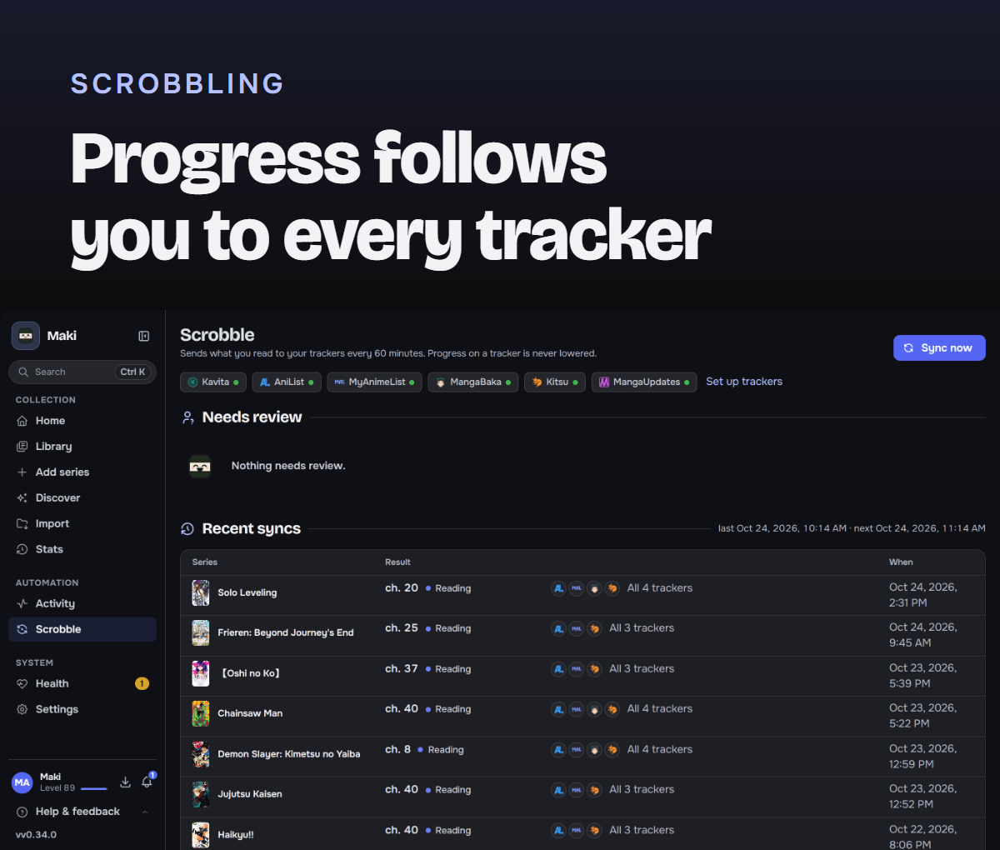
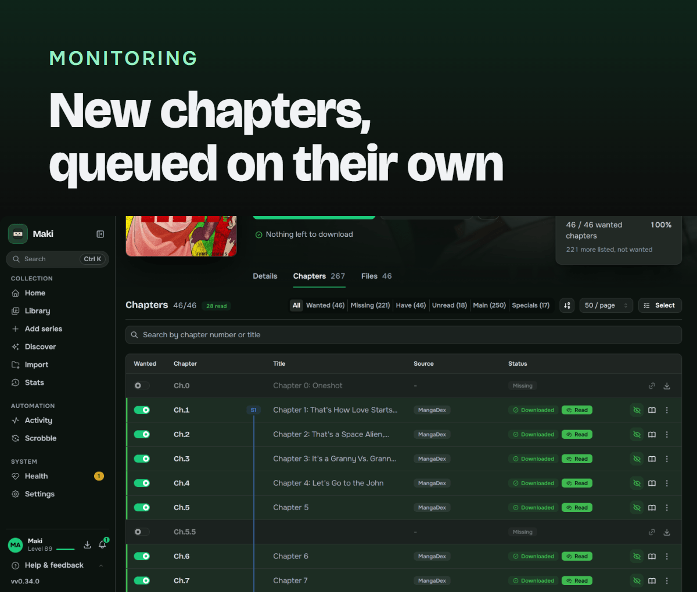
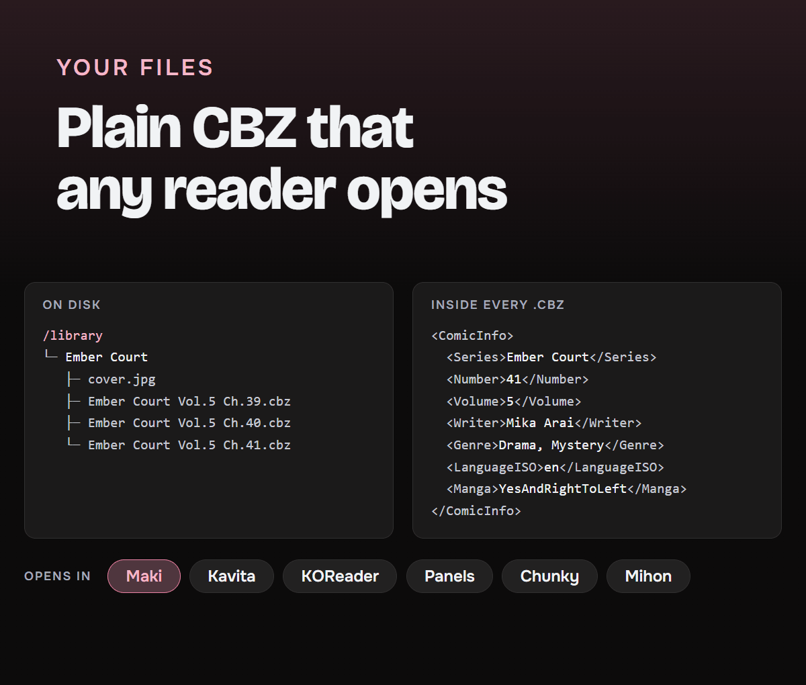
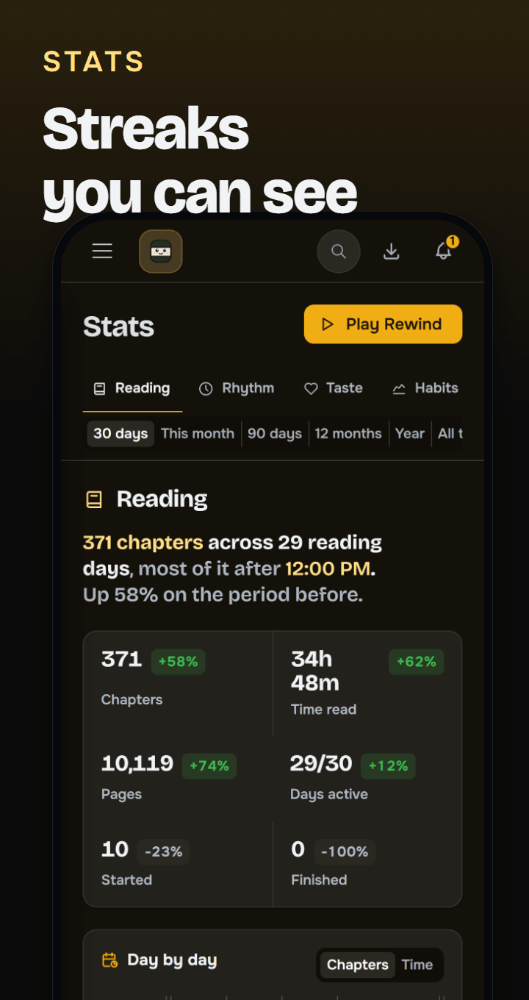

<p align="center">
  <a href="docs/readme/banner.png"></a>
</p>

---

<h1 align="center"> Maki</h1>

<p align="center">
  Add a series once and Maki keeps it complete.<br>
  A self-hosted manga manager in the spirit of <a href="https://sonarr.tv">Sonarr</a> and <a href="https://radarr.video">Radarr</a>, with a reader built in.
</p>

<p align="center">
  <a href="https://github.com/OrbitMPGH/Maki/releases"></a>
  <a href="https://github.com/OrbitMPGH/Maki/actions/workflows/ci.yml"></a>
  <a href="LICENSE"></a>
  <a href="https://hosted.weblate.org/engage/maki/"></a>
</p>

<p align="center">
  <a href="#overview">Overview</a> ·
  <a href="#why-maki">Why Maki</a> ·
  <a href="#quick-start">Quick start</a> ·
  <a href="#download">Download</a> ·
  <a href="#sources">Sources</a> ·
  <a href="#documentation">Documentation</a> ·
  <a href="#languages">Languages</a>
</p>

---

<p align="center">
  <a href="docs/readme/recommendations.png"></a>
  <a href="docs/readme/scrobbling.png"></a>
</p>
<p align="center">
  <a href="docs/readme/monitoring.png"></a>
  <a href="docs/readme/files.png"></a>
</p>
<p align="center">
  <a href="docs/readme/phone-home.png"></a>
  <a href="docs/readme/phone-reader.png"></a>
  <a href="docs/readme/phone-discover.png"></a>
  <a href="docs/readme/phone-stats.png"></a>
</p>

## Overview

Maki watches manga sites for new chapters, downloads the pages and writes CBZ files with
ComicInfo.xml metadata. [Kavita](https://www.kavitareader.com) and most comic readers understand
that format, so the same folder works everywhere. You can also read in Maki's own reader, over
OPDS in Panels, Chunky, KOReader and Mihon, or in apps that speak Komga's API.

> [!NOTE]
> Maki is almost entirely AI-slop-built, developed with Anthropic's latest Claude models. It is
> pre-1.0, so the schema and API can still change between releases. Issues and pull requests are
> welcome.

## Why Maki

- **Recommendations from your own library.** Local embeddings over the
  [MangaBaka](https://mangabaka.org) catalog suggest what to read next, with rails for blind
  spots, Readers like you and Your Taste. It all runs on your server.
- **Automatic monitoring.** Maki checks your sources on a schedule, picks the best one for each
  series and queues new chapters as they appear. Series that release often are checked every
  30 minutes, and an Upcoming view shows when the next chapter is likely. More than 30 sources
  are built in, in over a dozen languages, and optional Suwayomi support adds its extensions on
  top. Torrents through Prowlarr or Jackett, sent to qBittorrent, Transmission or Deluge, work the
  same way.
- **Scrobbling.** Reading progress goes to AniList, MyAnimeList, Kitsu, MangaBaka and
  MangaUpdates, whether you read in Maki, over OPDS or in Kavita.
- **Plain files, any reader.** Everything is saved as CBZ with ComicInfo.xml. Kavita, KOReader,
  Panels, Chunky, Mihon or any other comic reader can use the same folder, and nothing is locked
  inside Maki's database.
- **A reader when you want one.** Paged, double-page or continuous scroll, with progress merged
  across every app you read in. Install Maki to your phone's home screen and save chapters to
  read offline.

Also included: multiple users with per-folder access, two-factor and OpenID Connect, notifications
to Discord, Telegram, ntfy and more plus push to your devices, Mihon backup import, optional
WebP/AVIF page conversion, stats and Rewind, eleven languages, a REST API and one-click backups.
The full list is in [docs/features.md](docs/features.md).

## Quick start

```yaml
services:
  maki:
    image: ghcr.io/orbitmpgh/maki:latest
    container_name: maki
    environment:
      - PUID=1000
      - PGID=1000
    volumes:
      - ./maki-config:/config
      - /path/to/manga-library:/library
    ports:
      - "8990:8990"
    restart: unless-stopped
```

1. Open `http://localhost:8990` and create the administrator account.
2. The setup guide opens next. Add `/library` as a library folder there. Maki downloads the
   local [MangaBaka](https://mangabaka.org) database in the background (about 350 MB, 3.5 GB on
   disk) and finishes opening once it is installed.
3. Click **Add series**, search for a title and pick it. Maki links sources and syncs chapters in
   the background.
4. Download a chapter or click **Search all missing**, then follow progress under **Activity**.

Kavita, FlareSolverr and Suwayomi are optional. A compose file with all of them is in
[docs/docker-compose.example.yml](docs/docker-compose.example.yml). If you use FlareSolverr, set its
URL under **Settings → Downloads → FlareSolverr** to `http://flaresolverr:8191` and hit **Test**. For
Suwayomi, set `http://suwayomi:4567` under **Settings → Integrations → Suwayomi**, hit **Test**,
then **Manage sources** to turn on the ones you want.

Offline reading and push notifications need HTTPS. See
[Exposing Maki to the internet](docs/exposing-to-the-internet.md) for a reverse proxy setup.

Upgrading from a single-user Maki? The first page asks you to set a username and password. Your
library, history and tracker connections are already attached to that account.

## Download

| Platform | Status | Get it |
|---|---|---|
| Docker (amd64, arm64) | Supported | `ghcr.io/orbitmpgh/maki:latest` |
| Unraid | Supported | Search for Maki in the Apps tab on your Unraid server |
| From source | Supported | .NET 10 and Node 24, see [docs/development.md](docs/development.md) |

## Sources

35 sources are built in, from official publisher sites to scanlation groups, in over a dozen
languages. Nothing to install. If you already run [Suwayomi](https://github.com/Suwayomi/Suwayomi-Server),
point Maki at it and its extensions appear next to the built-in sources.

<details>
<summary>Show all sources</summary>

Notes on languages, FlareSolverr and mirror overrides are also in
[docs/sources.md](docs/sources.md).

| Source | Notes |
|---|---|
| MangaDex | Official API, language filter |
| MANGA Plus | Official (Shueisha), language-specific mappings |
| WEBTOON | Official (webtoons.com), ORIGINALS and CANVAS in en, id, th, es, fr, zh-Hant, de |
| Naver Webtoon | Official (comic.naver.com), Korean, WEBTOON tier only |
| GigaViewer sites | Official Japanese: Shonen Jump+, Comic Days, Sunday Webry, MAGCOMI, Tonari no Young Jump, Comic Zenon, Kurage Bunch (free episodes only) |
| KadoComi (Comic Walker) | Official, Japanese |
| MangaPill | |
| Weeb Central | Requires FlareSolverr |
| MangaFire | Language filter, requires [FlareSolverr](https://github.com/FlareSolverr/FlareSolverr) |
| TCB Scans | Domain override via `MAKI_SOURCE_TCBSCANS_BASEURL` |
| Asura Scans | Manhwa/manhua |
| Flame Comics | Manhwa/manhua, requires FlareSolverr |
| TopManhua | Manhwa/manhua, requires FlareSolverr |
| MangaKatana | |
| MangaKakalot | Requires FlareSolverr |
| Atsumaru | atsu.moe |
| Dynasty Scans | English, yuri |
| Toonily | Manhwa, adult, requires FlareSolverr |
| Manhwa18.net | Adult, requires FlareSolverr |
| Baozi Manhua | Simplified Chinese manhua |
| Manhuagui | Simplified Chinese, mirror override via `MAKI_SOURCE_MANHUAGUI_BASEURL` |
| Manga Livre | Brazilian Portuguese |
| Taiyō | Brazilian Portuguese |
| ManhwaWeb | Spanish |
| Olympus Scanlation | Spanish, requires FlareSolverr |
| Anime-Sama | French, requires FlareSolverr |
| Manga-Tube | German |
| MangaWorld | Italian |
| MangaLib | Russian |
| MangaDenizi | Turkish |
| Shinigami | Indonesian, manhwa/manhua/manga |
| Cứu Truyện | Vietnamese, FlareSolverr when challenged, mirror override via `MAKI_SOURCE_CUUTRUYEN_BASEURL` |
| Team-X | Arabic, requires FlareSolverr; the domain rotates, override it with `MAKI_SOURCE_TEAMX_BASEURL` |
| Sen Manga | Japanese raws |
| Rawkuma | Japanese raws, FlareSolverr when challenged, mirror override via `MAKI_SOURCE_RAWKUMA_BASEURL` |

</details>

## Documentation

| Guide | Covers |
|---|---|
| [Features](docs/features.md) | Everything Maki does, in full |
| [Sources](docs/sources.md) | The built-in sources and Suwayomi |
| [Multiple readers](docs/multiple-readers.md) | Per-user data, library access, Kavita |
| [Offline reading](docs/offline-reading.md) | Installing as an app, saving chapters, push |
| [KOReader](docs/koreader.md) | OPDS downloads and progress sync |
| [Exposing Maki to the internet](docs/exposing-to-the-internet.md) | HTTPS, trusted proxies, two-factor |
| [Single sign-on](docs/single-sign-on.md) | OpenID Connect setup and claim mapping |
| [Backup and restore](docs/backup-restore.md) | Snapshots, migrations, restoring |
| [Development](docs/development.md) | Building the image, running from source, architecture |

## Languages

The interface ships in English, German, French, Spanish, Brazilian Portuguese, Polish, Russian,
Turkish, Japanese, Simplified Chinese and Korean. Everything except English is machine-translated
and marked as needing review. Fixing a string on
[Hosted Weblate](https://hosted.weblate.org/engage/maki/) is the easiest way to help. More in
[docs/languages.md](docs/languages.md).

## Legal

Maki is a tool for organizing your library. Scraper sources access third-party websites. You are
responsible for complying with those sites' terms of service and your local laws. Support the
industry: buy official releases.

## License

[GPL-3.0](LICENSE)
