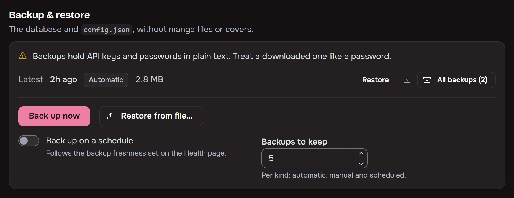
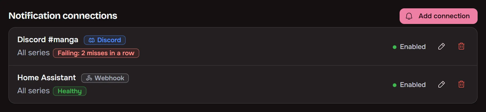
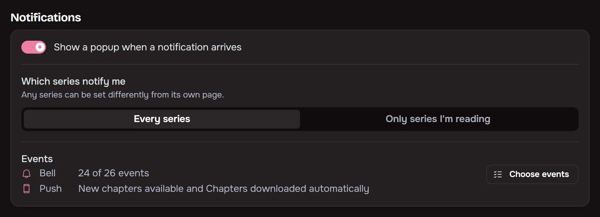
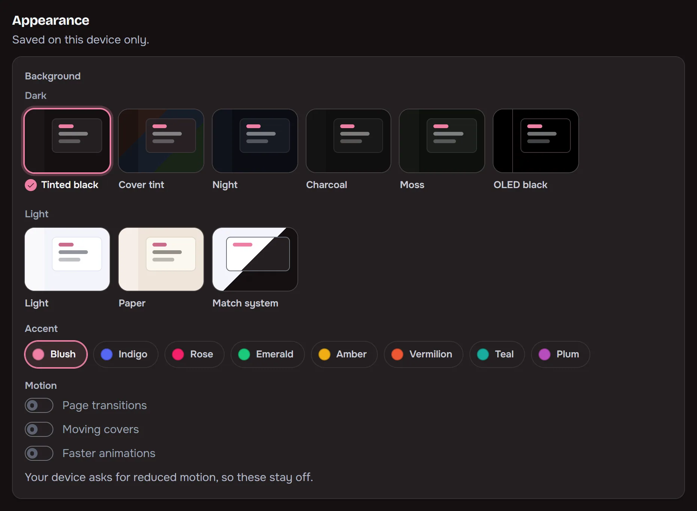

## Multi-user

Per-user history, preferences and tracker accounts over one shared library, with per-root-folder
access grants. While only one account is enabled, single-user mode hides requests, leaderboards and
the other multi-user parts. See [Multiple readers](/Maki/guides/running/users-and-access/).

## Security

Two-factor authentication, per-user API keys, HTTPS enforcement, trusted proxies, lockout and
OpenID Connect single sign-on. See
[Exposing Maki to the internet](/Maki/installation/reverse-proxy-https/).

An opt-in access log can feed CrowdSec or fail2ban. See
[Access log and CrowdSec](/Maki/installation/access-log-crowdsec/).

## Backup & restore

One-click zip of database and settings, plus an automatic safety backup before every schema
migration. See [Backup & restore](/Maki/guides/running/backup-restore/).

## Notifications

Outbound events (new chapters, download results, health warnings and more) go to Discord, Telegram,
Slack, Notifiarr, ntfy, Gotify, Pushover, Apprise or a plain webhook.

Connections can be scoped to user tags so each person only hears about their own series. Each user
picks which events show in the bell and which push to their devices.

## Interface

- Eleven UI languages.
- Eight accent colours (Blush by default) and nine backgrounds, including Cover tint (takes the
  colour of the cover on screen), OLED black and the light Paper.
- The sidebar can collapse into a slim header.
- Page transitions can be turned off or sped up under Settings, Preferences, Appearance, Motion.
- The sign-in page can show a blurred mosaic of Safe-rated covers. Admins turn this on under
  Settings, Users & security, Sign-in page.

## REST API

Available at `/api/v1` with `X-Api-Key` auth. Swagger is served at `/swagger` when running in the
Development environment.
