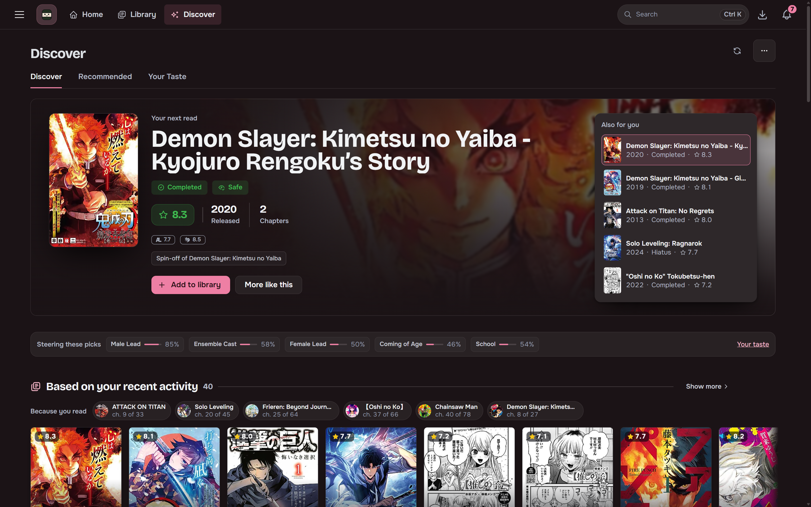
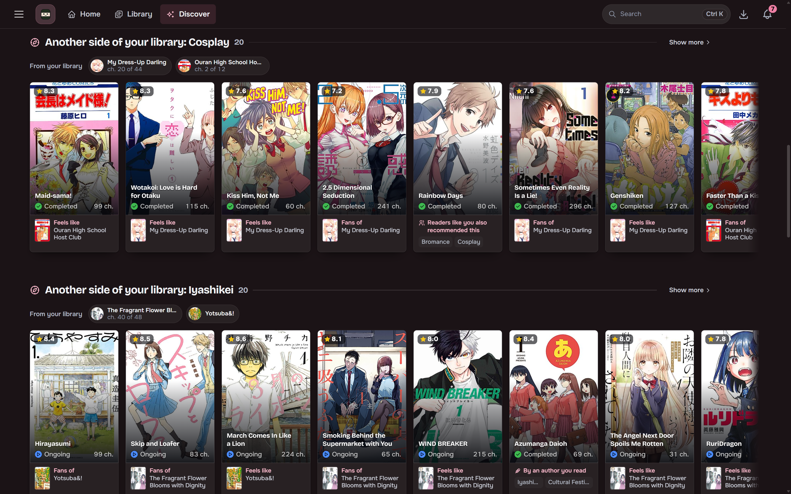
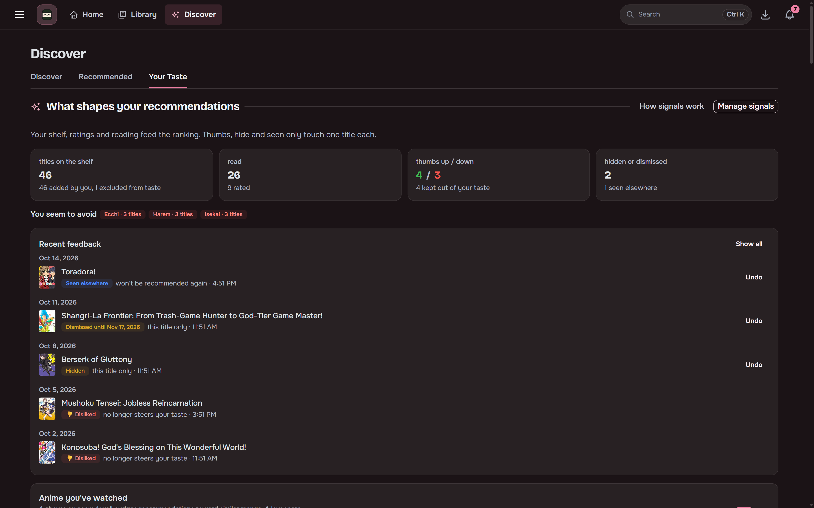
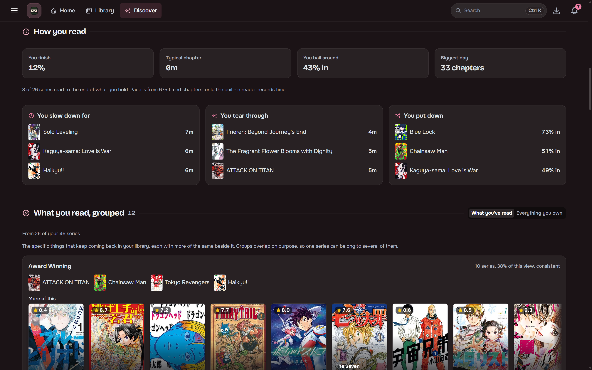

## Recommendations

Local ONNX embeddings over the MangaBaka dump find titles similar to your library. Seed them from
your whole library or from specific titles, and filter by year, rating, type, status, genre,
chapter count and content rating. A dial moves the picks from popular to obscure.

## Discover

The Discover tab has catalog and genre rails, recent-reading picks, side interests and
**Readers like you**. **Your Taste** is its own tab, showing reading behavior, grouped interests
and how your taste has moved.

Every rail has a fullscreen **Show more** view. Detail cards show categorized tags, alternate
titles, creators, per-source ratings and MyAnimeList reviews.

## Metadata

One MangaBaka search identifies a series and brings along its MyAnimeList, AniList, MangaUpdates
and Kitsu IDs.

The local [MangaBaka dump](https://mangabaka.org/data/database) (nightly snapshot, about a 350 MB
download and 3.5 GB on disk) answers every metadata lookup, so search and library imports are
instant. A series MangaBaka added after the latest snapshot shows up with the next one.
MangaBaka-original data is [CC BY-NC-SA 4.0](https://creativecommons.org/licenses/by-nc-sa/4.0/).
