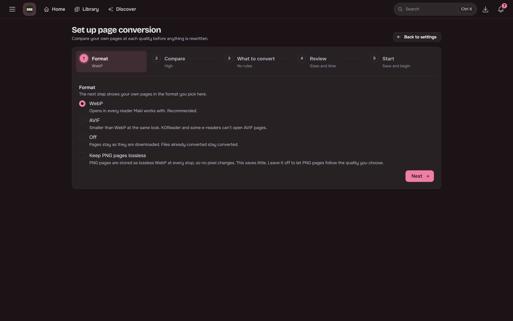
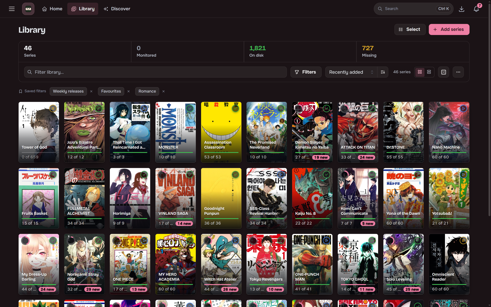
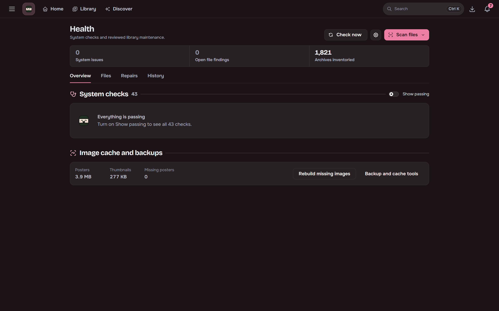

## Output

The default layout is one folder per series, such as `Berserk (1989)`, holding files such as
`Berserk Vol.3 Ch.24.cbz`, with configurable folder and file naming. ComicInfo.xml carries series,
chapter number, volume, authors, genres, language and reading direction. Files are written
atomically, so a reader never sees a half-written CBZ. Maki can also write a `cover.jpg` into each
series folder for readers that look for one, if you turn on **Save a cover.jpg into each series'
library folder** under Settings, Library.

## Page conversion

Off by default (Settings, Library, Page conversion). Pick WebP or AVIF and a quality. New downloads
are stored with their JPEG pages in that format, unless the quality is Lossless. PNG pages are
lossless WebP at the Lossless stop or with **Keep PNG pages lossless** on, and follow the quality
otherwise.

There are five quality stops, Smallest, Compact, Balanced, High and Lossless, and High is the
default. The setup wizard compares one of your own pages at each stop before anything is rewritten,
and per-file rules or a series' own setting can change which stop applies. Each series can be
undone on its own. See [WebP and AVIF conversion](/Maki/guides/library/page-conversion/).

A pausable library pass converts the files already on disk, one at a time, and shows what it saved.
Several pages of a file are encoded at once; the card sets how many (by default half the cores,
between 2 and 4).

**Skipped on purpose**

- A page or file that would not come out at least 5% smaller.
- WebP and AVIF pages, animations, pages under 16 KB and pages over 16,383 pixels on a side.
- Files hardlinked to a torrent client's copy.

Originals wait in the upgrade trash (`.maki-trash/<series id>/conv-*`) for the trash retention
period. The pass pauses itself rather than leave less than 1 GB free.

**Compatibility.** WebP opens in every reader Maki works with (browsers, Kavita, Komga, KOReader,
Mihon, Panels). AVIF does not open in KOReader or on iOS before 16. JPEG XL is not offered: the
image library Maki bundles cannot write it, and Kavita and KOReader cannot read it.

Upgrades, source quality estimates and the quality shown on the series page keep judging a
converted chapter by the size and format it was downloaded in, so converting never makes a copy
look like a worse release.

## Library view

Grid or list view with density options. Shows download state, read badges and monitor status.
Filter by source, chapter count or user tag, save filters, and set monitoring for the selected
series in bulk. Per-series incognito mode keeps a title out of stats and progress without hiding it.

Archived series sit under **Archived (N)**, where you can restore them or remove their files in
bulk. See [Archiving a series](/Maki/guides/library/archiving/).

## Library health

Admins can index and verify archives, and find missing, unreadable, duplicate or suspicious files.
Repeated findings of one kind fold into one row with **Acknowledge all**. Replacement and deletion
operations are reviewed before they run, and unlinked CBZs can be imported. The History tab
keeps a timeline of status changes, and failed repairs can be retried or dismissed. See
[Health checks](/Maki/guides/running/health-checks/).

## Mihon backup import

Upload a Mihon backup (`.tachibk` or `.proto.gz`) on the Import page to add its library. Entries
are matched by tracker ids, then by title, with a review table for fixes. Categories become tags
and read chapters are marked read.
