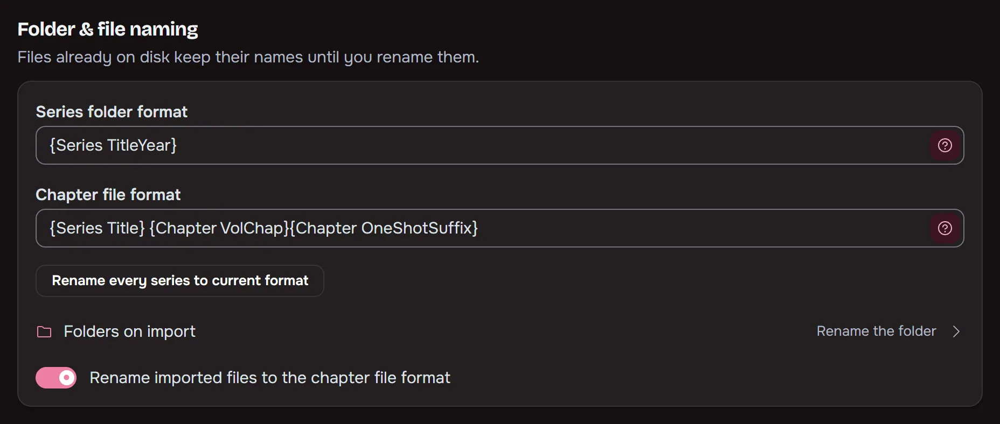
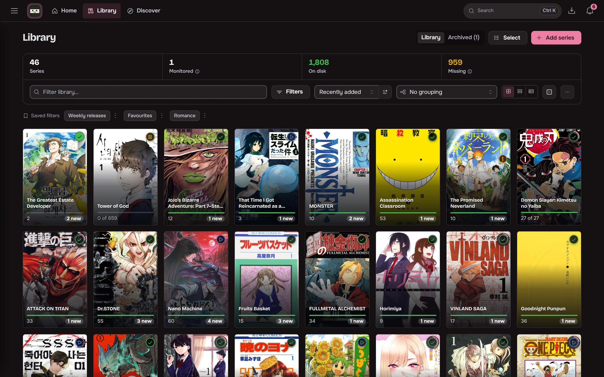
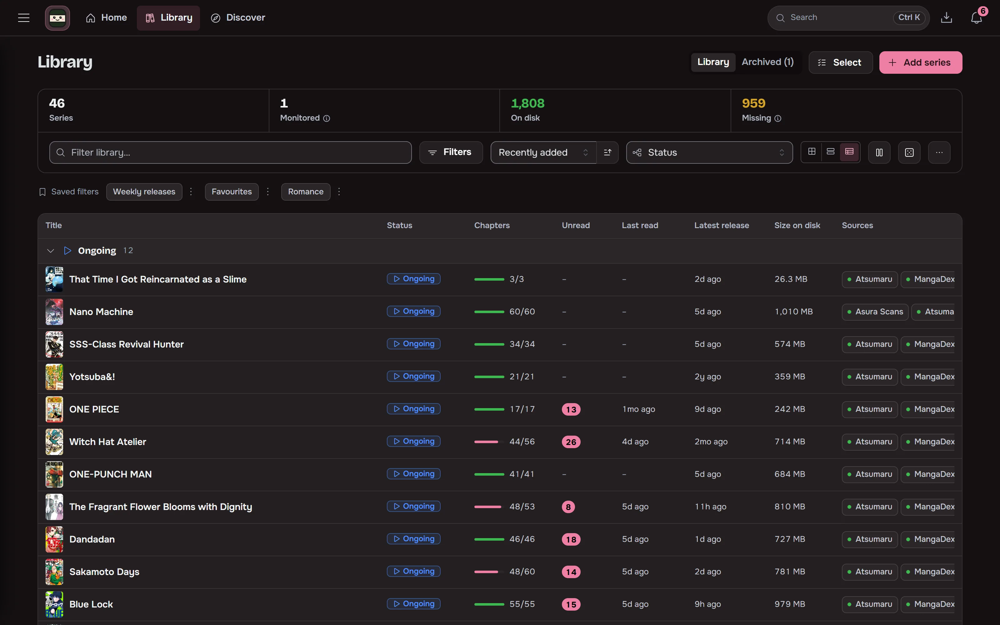
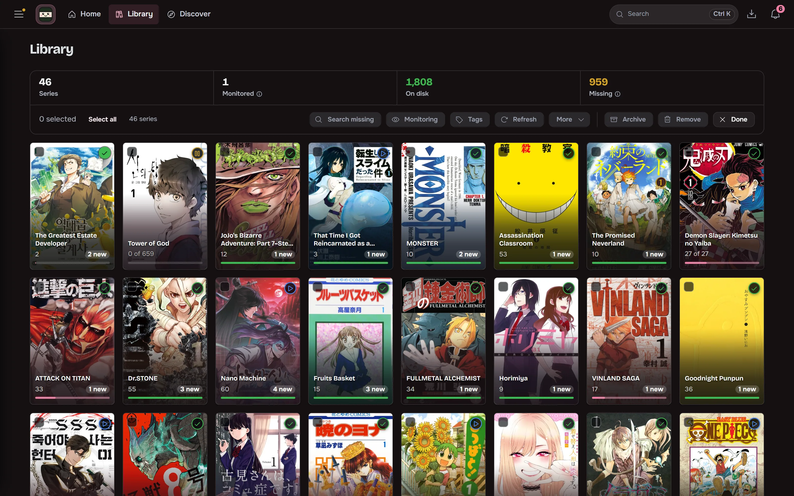
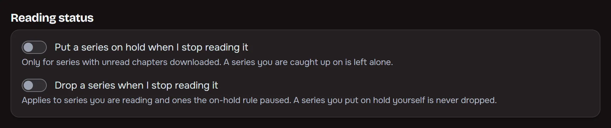
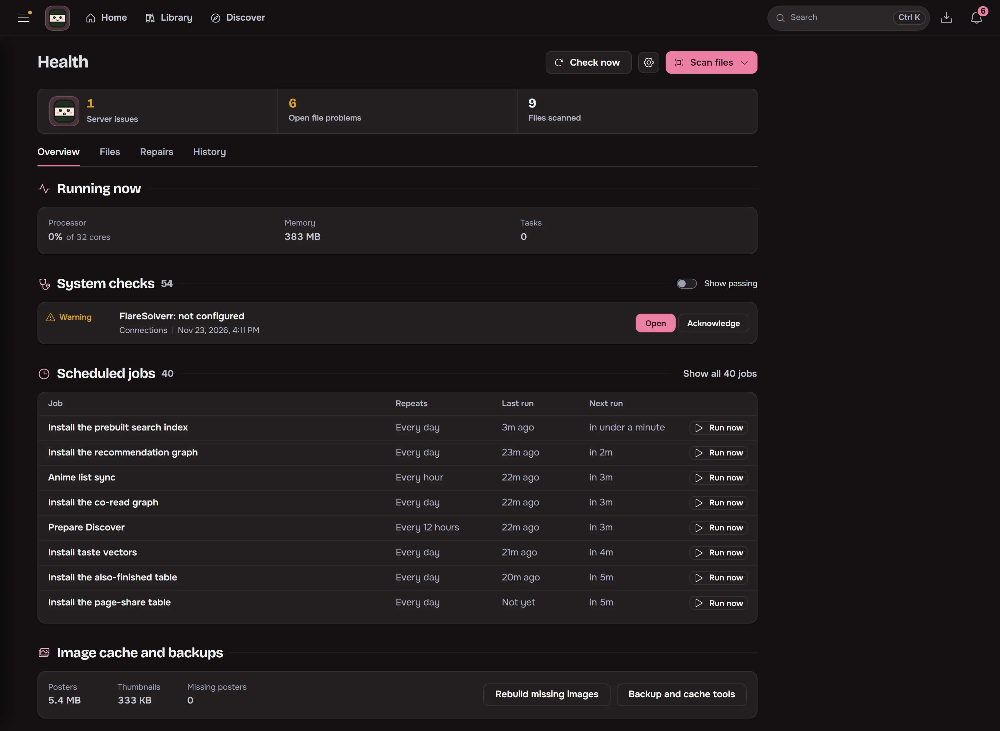
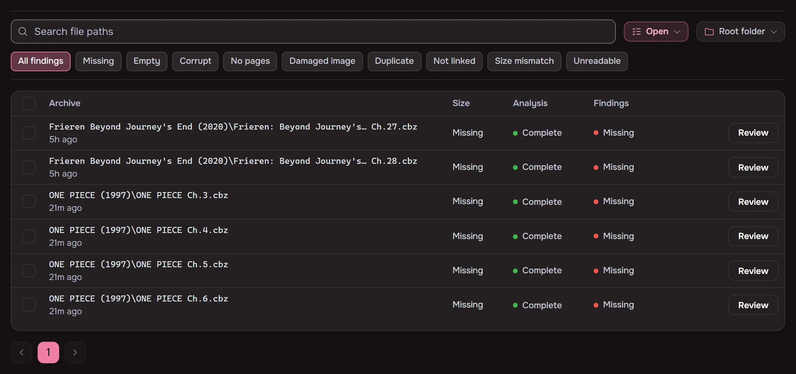

## Output

The default layout is one folder per series, such as `Berserk (1989)`, holding files such as
`Berserk Vol.3 Ch.24.cbz`, with configurable folder and file naming. ComicInfo.xml carries series,
chapter number, volume, authors, genres, language and reading direction. Files are written
atomically, so a reader never sees a half-written CBZ. Maki can also write a `cover.jpg` into each
series folder for readers that look for one, if you turn on **Save a cover.jpg into each series'
library folder** under Settings, Library.

## Page conversion

Off by default (Settings, Library, Page conversion). Pick WebP, AVIF or JPEG XL and a quality, with
separate targets for black-and-white and colour pages, so colour inserts can go to JPEG XL while
the manga around them goes to AVIF. New downloads are stored with their JPEG pages in that format,
unless the quality is Lossless. PNG pages are lossless WebP at the Lossless stop or with **Keep PNG
pages lossless** on, and follow the quality otherwise.

There are five quality stops, Smallest, Compact, Balanced, High and Lossless, and High is the
default. Setup is one page: per-file rules and the default sit in one table, each target previews
on your own pages of that kind, and each row shows how big its files would end up. A series' own
setting can change which rule applies. Each series can be undone on its own. See
[Page conversion](/Maki/guides/library/page-conversion/).

Conversion can also split very tall webtoon pages into shorter ones in the blank gaps between
panels, which e-readers and KOReader handle far better.

New downloads, upgrades and torrent imports are converted in a background queue after they land, so
downloads finish sooner. A file waits while someone is reading it, and the page conversion card
shows how many files are queued.

A pausable library pass converts the files already on disk, one at a time, and shows what it saved.
Several pages of a file are encoded at once; the card sets how many (by default half the cores,
between 2 and 4).

**Skipped on purpose**

- A page or file that would not come out at least 5% smaller.
- WebP, AVIF and JPEG XL pages, animations, pages with more than 8 bits per channel, pages under
  16 KB and pages over 16,383 pixels on a side.
- Files hardlinked to a torrent client's copy.

Originals wait in the upgrade trash (`.maki-trash/<series id>/conv-*`) for the trash retention
period. The pass pauses itself rather than leave less than 1 GB free.

**Compatibility.** WebP opens in every reader Maki works with (browsers, Kavita, Komga, KOReader,
Mihon, Panels). AVIF does not open in KOReader or on iOS before 16. JPEG XL pages are about the size
of WebP's and convert about three times faster. Maki's reader shows them as they are in browsers
that support JPEG XL and as WebP everywhere else, and OPDS, Komga and KOReader always get WebP pages.
A CBZ you download keeps its JPEG XL pages, which KOReader and most comic apps cannot open.

Upgrades, source quality estimates and the quality shown on the series page keep judging a
converted chapter by the size and format it was downloaded in, so converting never makes a copy
look like a worse release.

## Library view

Grid, list or table view, with density options. Shows download state, read progress and monitor
status. Each cover has a menu on hover or focus to open, continue, monitor or mute the series.
Reading progress is a ring around the status disc, which turns into a check once you've read
everything. "N new" counts the unread chapters in the series' latest batch of added files. The
title filter tolerates typos, and shows the closest titles when nothing matches exactly.

- **Table view.** A small cover and the title, plus columns you pick and order yourself: status,
  chapters, unread, added, last read, latest release, size on disk, sources, quality profile, next
  check, year, author, community score, your rating and tags. Click a header to sort, drag its edge
  to resize, double-click the edge to reset.

  

- **Group by** status, tag, type or root folder (root folder only with more than one). Each group
  has a header with its count and folds away on click. A series with several tags is listed under
  each of them.
- **Filters.** Status, reading status, type and your most common genres are chips at the top of the
  filter panel. Every other filter opens its own page in the panel: source, chapter count, year
  range, author or artist, publisher, root folder, tags and genres (include or leave out), incognito,
  muted notifications, anime adaptation, numbering clash, series with their own read file cleanup or
  page conversion setting, and series added within the last N days.
- **Sorts** include year, community score, most unread, latest chapter released, chapter count and
  author. Series with no value for a sort always go last.
- **Saved filters** can be renamed, reordered, and one can be the view the Library opens with. The
  search, sort, filters, grouping and view also live in the address bar, so a view can be bookmarked
  or sent to someone.
- **Select mode** works on a range with shift-click. Bulk actions: refresh, rescan files, metadata,
  search missing, monitoring, move, rename files, mark read or unread, reading status, incognito,
  clean up read files and page conversion. They run on the server as one job, keep going if you
  close the tab, and can be stopped.

Per-series incognito mode keeps a title out of stats and progress without hiding it.

Every series also has your own **reading status**: Plan to read, Reading, Completed, On hold or
Dropped. A new series starts as Plan to read, and reading it anywhere Maki can see moves it to
Reading. It becomes Completed when MangaBaka lists the series as completed and you have read every
chapter its progress counts. On hold and Dropped series leave Continue reading until you read them
again. Connected trackers get the status too. **Settings, Reading status** can put a series on hold,
or drop it, after a number of days without reading, counting only days when something was waiting
to be read.

**Auto-tag rules** (Settings, Library) tag a series as it is added when it matches every condition
you set: genre, type, content rating, root folder, who added it, and how it came in. **Apply to
existing series** on a rule tags what is already in the library, after showing how many series it
will tag.

Archived series sit under **Archived (N)**, where you can restore them or remove their files in
bulk. See [Archiving a series](/Maki/guides/library/archiving/).

## Library health

Admins can index and verify archives, and find missing, unreadable, duplicate or suspicious files.
A missing archive that moved, for example after a series folder was renamed outside Maki, is found
by name, size and page hashes and relinked by itself after each library scan. A match on name alone
waits on the Missing filter for you to confirm. Spare duplicates can be deleted in one click. The
Overview tab also shows what Maki is busy with right now and the scheduled jobs, with **Run now**. Repeated findings of one kind fold into one row
with **Acknowledge all**. Replacement and deletion
operations are reviewed before they run, and unlinked CBZs can be imported. The History tab
keeps a timeline of status changes, and failed repairs can be retried or dismissed. See
[Health checks](/Maki/guides/running/health-checks/).

## Mihon backup import

Upload a Mihon backup (`.tachibk` or `.proto.gz`) on the Import page to add its library. Entries
are matched by tracker ids, then by title, with a review table for fixes. Categories become tags
and read chapters are marked read.
