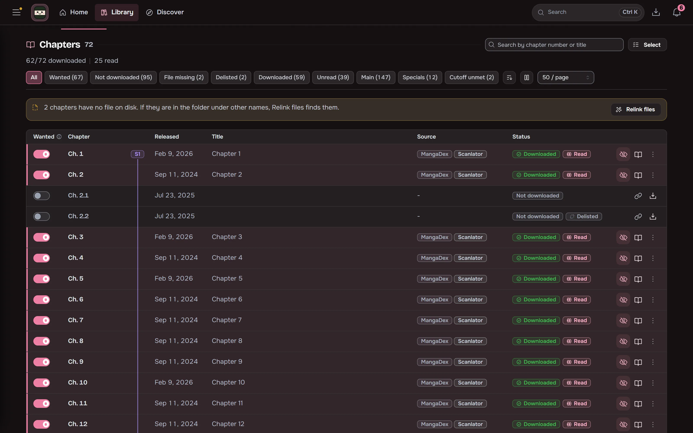
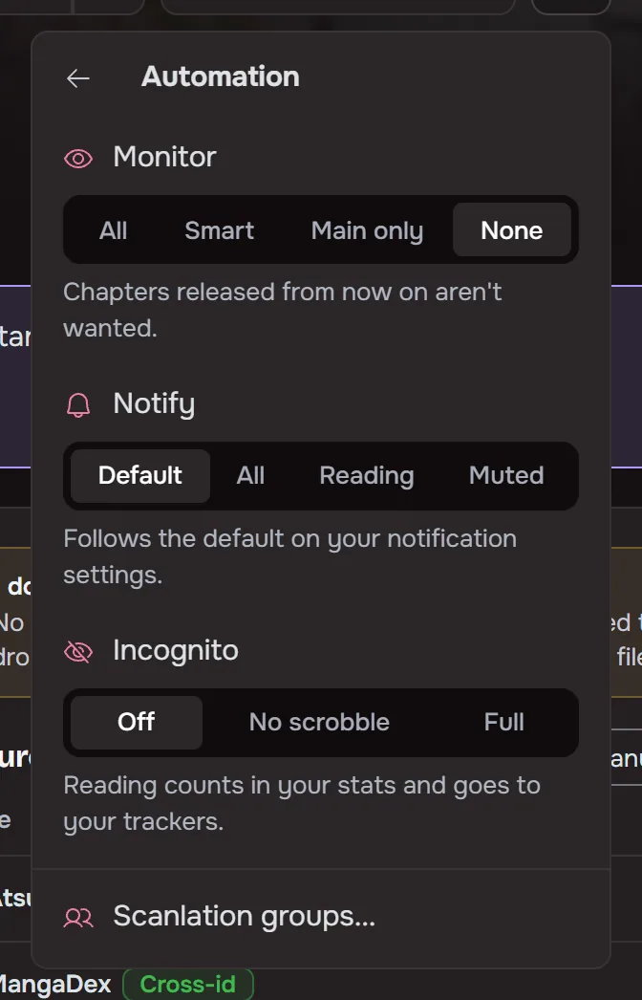
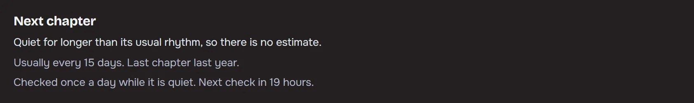
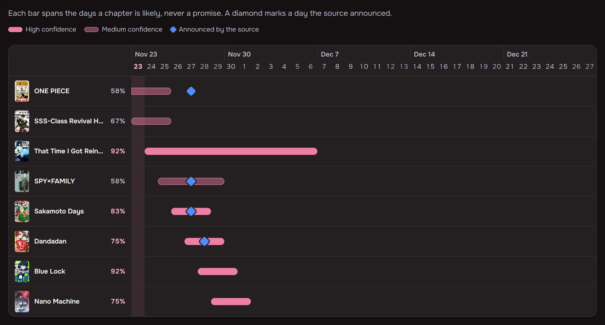
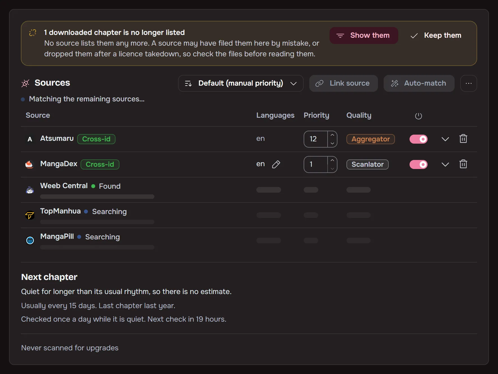
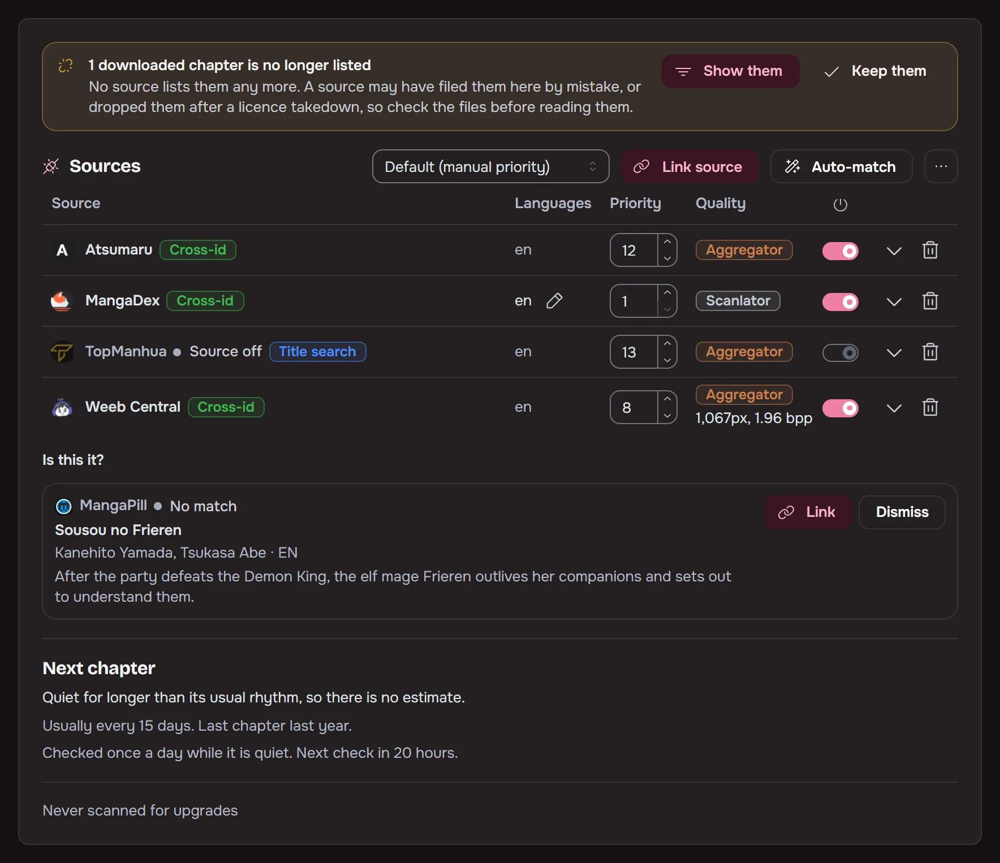
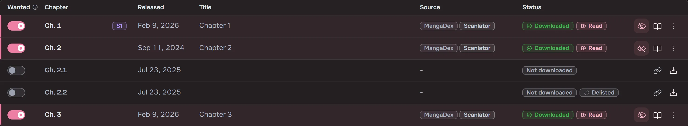
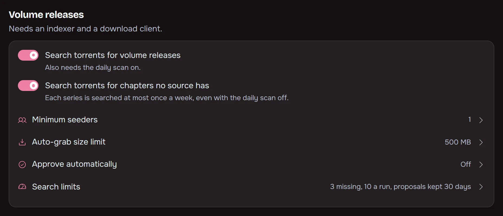
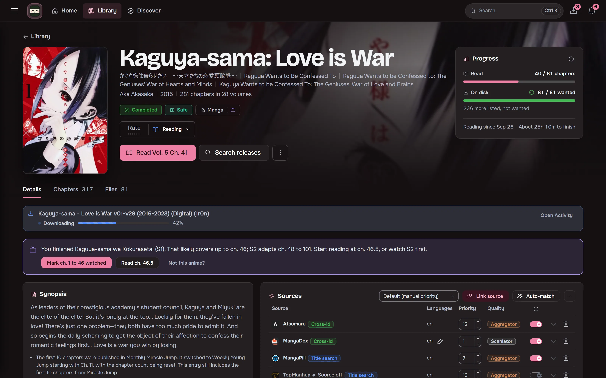
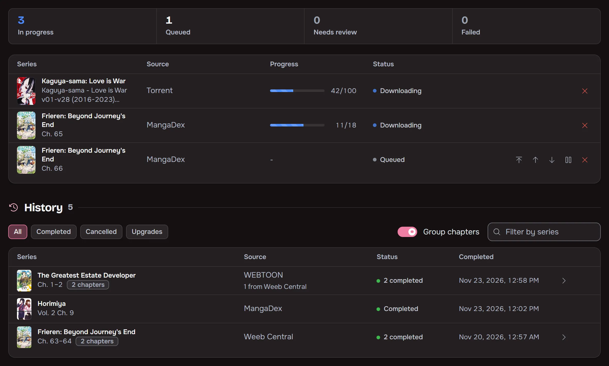

## Monitoring

Chapter lists refresh on a schedule and new chapters are queued automatically. Whole-series monitor
modes decide what gets queued, and a per-chapter **Wanted** toggle keeps individual chapters or
specials out.

## Release-aware refresh

A series with a new chapter in the last six hours is checked every 30 minutes. One with a chapter
in the last two weeks is checked every 2 hours, and one with a chapter in the last 60 days every 6
hours (or with no dated chapter yet). Completed series with nothing new in two weeks, and series
quiet for longer, are checked once a day. A new chapter puts a series back on the fast schedule.
Turn off **Check quiet series less often** in Settings, Downloads to check everything every 30
minutes.

## Upcoming

The Upcoming tab in Activity shows each series' likely next chapter on a five-week grid, as a span
with a confidence rather than a date. Release times a source announces (MANGA Plus) are shown on
the day, and Maki checks again just after them. The series page shows the same estimate and when
the next check is due.

## Automatic source matching

Adding a series returns instantly. Matching runs in the background and can be re-run or fixed by
hand.

- Sources are drag-ordered by preference and can be disabled globally.
- The series page can compare linked sources side by side on sampled page quality.
- A single chapter can be re-fetched from another linked source: pick the copy that looks best
  and Maki downloads it again from there.
- A result that comes close to the series title but not close enough to link on its own is offered
  as **Is this it?** with **Link** and **Dismiss**.
- On MangaDex you can prefer or block scanlation groups, for every series or for one. See
  [Choosing sources](/Maki/guides/sources/choosing-sources/#scanlation-groups-on-mangadex).
- A chapter that is still early access on one source is taken from another linked source that has
  it free, and only waits when none does.

Files that no source chapter claims still become chapters. A chapter file gets a row under its
number, and a volume file gets a row for each chapter its page names mark. A volume file with no
chapter marks gets one **Vol.N** entry per volume it spans, but only while no source lists any
chapter of the series. Entries can be read but are never downloaded. Chapter 0 and files with no
number are left alone. Once sources list chapters, numbered rows take their links, and each
entry gives way to the numbered chapters on its file, with its reads moving onto them.

## Delisted and missing chapters

A chapter that no enabled source lists any more is flagged as **Delisted**, with a badge and a
filter on the series page. An alert there offers **Show them** and **Keep them**. The flag clears
itself if a source lists the chapter again, and a sync that delists chapters you have files for
sends one inbox warning per series. Nothing is downloaded or deleted because of it.

Chapters no source has can still come from your indexers: **Search torrents for chapters no source
has** is on by default once an indexer and a download client are set up. See
[Torrents](/Maki/guides/sources/torrents/#getting-a-release).

A chapter whose file has gone from disk says **File missing**, with a count in the chapter heading,
a filter and a **Relink files** button. Downloaded counts leave these chapters out. See
[Health checks](/Maki/guides/running/health-checks/#missing-files-that-moved).

## Multilingual libraries

A series' link to a source can hold several languages, each with its own chapter rows and files,
with the language recorded in ComicInfo.xml. Per-user title-language preferences pick the display
title without renaming anything on disk.

## Torrents

Search releases through Prowlarr or Jackett, grab them with qBittorrent, Transmission or Deluge,
and auto-import on completion. Torrents share the queue with scraper downloads, and files are
hardlinked into the library where possible. A release whose title names a related work (a spin-off
or sequel) better than the series itself is rejected.

Maki can also remove a torrent from the client, right after import or once it reaches a seed ratio
or seeding time. This is off by default. Turn on **Remove torrents from the download client after
import** under **Settings → Downloads**, and **Also delete the downloaded files** under it to delete
the data as well. A torrent that stalls is failed after a limit you set, declined, and replaced by
the next best release. **Look for volume releases first** tries a volume release before downloading
a new series chapter by chapter. See [Torrents](/Maki/guides/sources/torrents/).

Anything that is not already CBZ is converted on the way in:

| Input | Result |
|---|---|
| `.zip` | Placed unchanged (a CBZ is a zip) |
| `.cbr`, `.rar`, `.7z`, `.tar` | Repacked as CBZ |
| Folder of loose images | One CBZ per folder |
| PDF | Kept as is and read in place |

Manual library import converts files the same way and leaves your originals in place.

## Activity queue

Updates live over SignalR with per-page progress. You can retry or remove items and review downloads
that need a decision, for example an import that would replace existing chapter files. New chapters
download ahead of big backlogs, one series can be paused on its own, a drive running low on space
holds the downloads for that root folder, and the queue shows roughly how long it has left. See
[Activity, Wanted and the queue](/Maki/guides/getting-started/activity-and-queue/).

