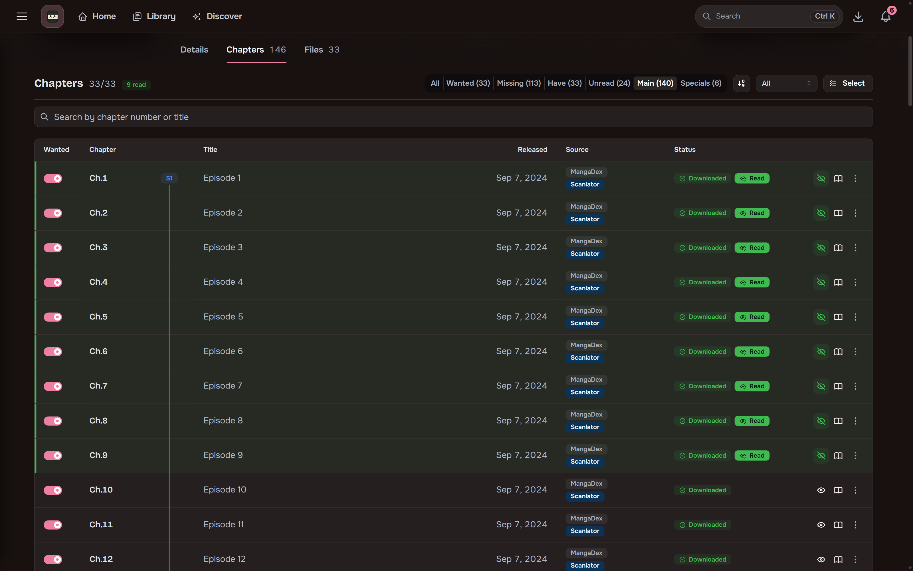
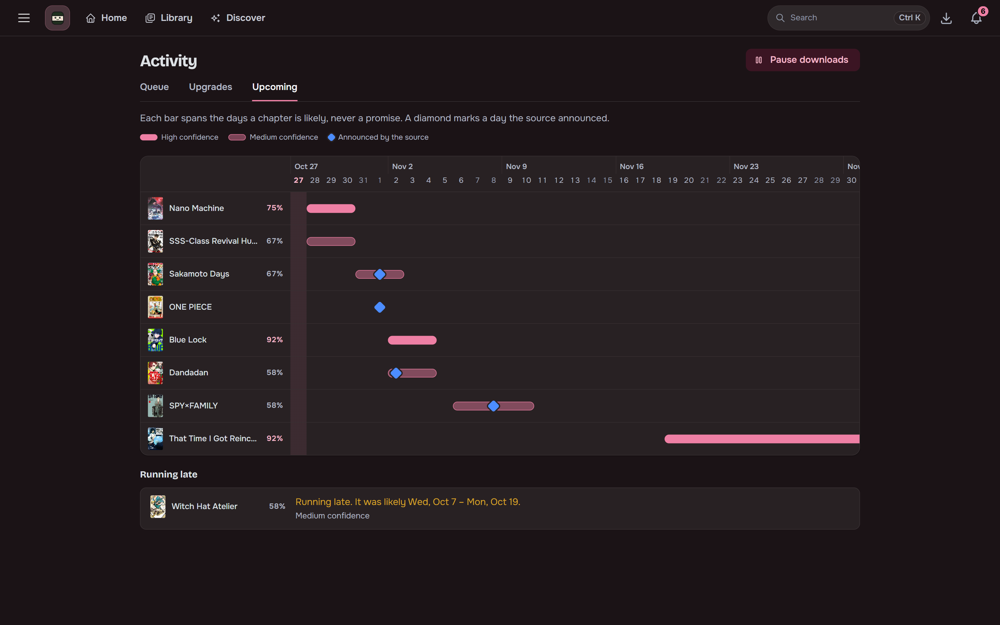
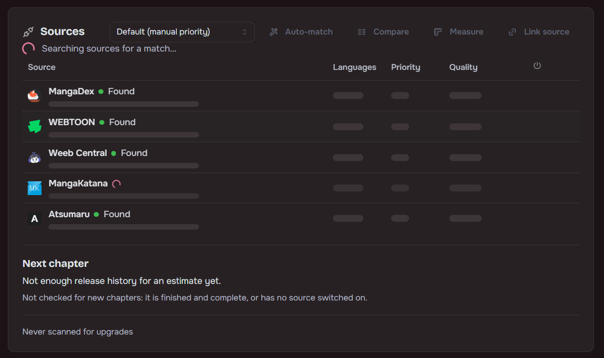

## Monitoring

Chapter lists refresh on a schedule and new chapters are queued automatically. Whole-series monitor
modes decide what gets queued, and a per-chapter **Wanted** toggle keeps individual chapters or
specials out.

## Release-aware refresh

A series with a new chapter in the last six hours is checked every 30 minutes. One with a chapter
in the last two weeks is checked every 2 hours, and one with a chapter in the last 60 days every 6
hours (or with no dated chapter yet). Completed series with nothing new in two weeks, and series
quiet for longer, are checked once a day. A new chapter puts a series back on the fast schedule.
Turn off **Check quiet series less often** in Settings, Downloads to check everything every 30
minutes.

## Upcoming

The Upcoming tab in Activity shows each series' likely next chapter on a five-week grid, as a span
with a confidence rather than a date. Release times a source announces (MANGA Plus) are shown on
the day, and Maki checks again just after them. The series page shows the same estimate and when
the next check is due.

## Automatic source matching

Adding a series returns instantly. Matching runs in the background and can be re-run or fixed by
hand.

- Sources are drag-ordered by preference and can be disabled globally.
- The series page can compare linked sources side by side on sampled page quality.
- A single chapter can be re-fetched from another linked source: pick the copy that looks best
  and Maki downloads it again from there.

## Multilingual libraries

A series' link to a source can hold several languages, each with its own chapter rows and files,
with the language recorded in ComicInfo.xml. Per-user title-language preferences pick the display
title without renaming anything on disk.

## Torrents

Search releases through Prowlarr or Jackett, grab them with qBittorrent, Transmission or Deluge,
and auto-import on completion. Torrents share the queue with scraper downloads, and files are
hardlinked into the library where possible. A release whose title names a related work (a spin-off
or sequel) better than the series itself is rejected.

Anything that is not already CBZ is converted on the way in:

| Input | Result |
|---|---|
| `.zip` | Placed unchanged (a CBZ is a zip) |
| `.cbr`, `.rar`, `.7z`, `.tar` | Repacked as CBZ |
| Folder of loose images | One CBZ per folder |
| PDF | Kept as is and read in place |

Manual library import converts files the same way and leaves your originals in place.

## Activity queue

Updates live over SignalR with per-page progress. You can retry or remove items and review downloads
that need a decision, for example an import that would replace existing chapter files.
