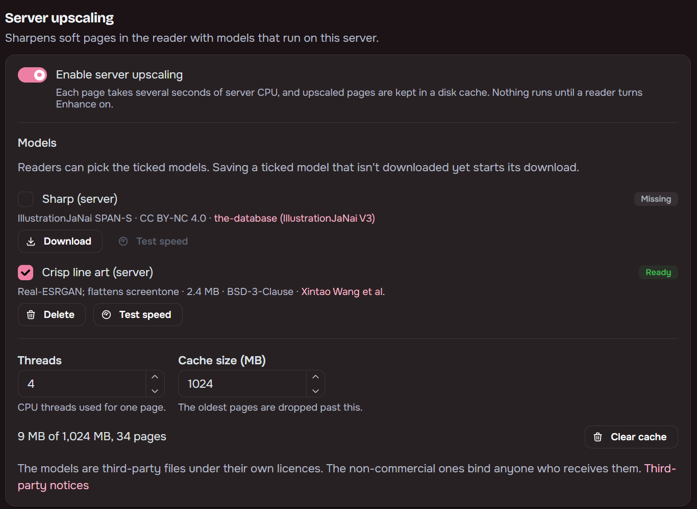

import ImageCompare from '../../../components/ImageCompare.astro';
import normal from '../../../assets/normal.png';
import upscaled from '../../../assets/upscaled.png';

Enhance sharpens soft, low-resolution pages in the built-in reader, which helps most on a large
screen. It is off until a reader turns it on. Library files are never modified.

<ImageCompare before={normal} after={upscaled} alt="Manga page" />

## Two tiers, one setting

- **Browser methods** (**Light**, **Balanced**, **Strong**) run Anime4K shaders on the reader's own
  device. They are always available and need WebGL2.
- **Server methods** (**Maki 2x**, **Real-ESRGAN**, **SPAN-S**) run ONNX models on the Maki
  server. They appear in the Method list under "On the server" once an admin has enabled them, and
  stay disabled, marked Downloading or Not available, until the model is ready. Maki 2x is Maki's own
  model, trained to look like Real-ESRGAN at about a third of the cost, and is the default and the
  recommended one. Real-ESRGAN (animevideov3) gives the crispest line art and flattens screentone.
  SPAN-S is IllustrationJaNai's sharp model. The settings page marks each one's speed and quality.

A greyscale page stays greyscale whichever method draws it.

## Turning it on

In the reader's settings panel, open **Enhance**, set it to Off, Auto or Always and pick a
**Method**. The same two fields are in reading profiles and in per-series overrides, so they follow
the usual order: series override, pinned profile, type profile, your default.

**Auto** enhances a page when it is shown at least 1.2 times larger than its source on either side,
or when the page looks soft and blurry at the size it is shown. A sharp page in a small window stays
plain, and so does a large page that is slightly soft at full size but sharp on screen.

Hold **H** or the toolbar's compare button to see the original page.

**Don't enhance** skips chapters by file quality. Tick any of **Volume**, **Official**,
**Scanlator**, **Aggregator** or **Unknown**, and chapters whose file has that tier show the plain
page and never reach the server queue. It starts with **Volume** ticked. With nothing ticked, the
placeholder reads "Every quality is enhanced". The tiers are described under
[Source tiers](/Maki/guides/library/chapter-upgrades/#source-tiers).

## Server progress

While a server method is still working on the page on screen, the fallback shows meanwhile. With
the reader's bars hidden, a thin line along the bottom edge shows the progress. With the bars
showing, the compare button and the page bar show it instead, and the page bar marks the pages ahead
that are already upscaled in light grey, like the buffered part of a video.

**Upscale progress** in the Enhance settings picks what shows while the bars are hidden: **Line**
(the default), **Detailed** (a pill that says whether the page is waiting, upscaling or loading) or
**Hidden**.

## Working ahead

Paged mode enhances the pages in the preload window. Continuous mode sizes its range by pixels
instead of pages, so a chapter of many short slices is enhanced well down the strip and one of a few
very tall slices only a page or two ahead, within what the device can hold. Near a chapter's end, a
server method also queues the next chapter's first pages, so it opens already upscaled.

Pages you have paged past drop out of the server queue, and a page still running is abandoned when
you skip ahead or switch chapter.

**Whole chapter**, off by default and shown only for server methods, keeps the server upscaling every
page of the open chapter, ahead first and then behind, so fast reading doesn't catch up with it.
Leaving the chapter cancels the rest.

## Fallbacks

A server method shows a browser method on this device while its page is not ready. The default is
**Balanced**. Choose **Light**, **Strong** or **None** (the plain page) under "While the server
works" in the reader settings, or "Fallback" in a reading profile.

The fallback stays on for good when the reader is offline, the admin tier is off or the model is not
downloaded. A device without WebGL2 shows plain pages, and the browser methods read "Not supported
on this device".

## Server upscaling (admins)

Settings, Library, **Server upscaling** has:

- the on switch and the list of models readers may use
- **Threads**
- the cache cap (1 GB by default) and **Clear cache**
- **Test speed**, which times one built-in sample page

Models are not bundled. Maki downloads each one from a Maki GitHub release when an admin ticks it
and saves, or from its Download button, and checks its SHA-256. Some are licensed for non-commercial use only; the per-model licences are in
[THIRD_PARTY_NOTICES.md](https://github.com/OrbitMPGH/Maki/blob/main/THIRD_PARTY_NOTICES.md).

A page takes seconds of server CPU, a few times longer on a NAS, so the queue is capped per reader
and shared fairly between readers. Each page is split into small tiles that run in parallel, and
flat areas skip the model. Pages over 16 megapixels are never upscaled on the server, since one can
take around 2 GB of memory. The reader uses the browser method for those pages instead.

Colour pages saved with a wide-gamut colour profile, such as Adobe RGB, are converted to sRGB before
upscaling.

## Privacy

Pages never leave your server or your device. The only outside traffic is model downloads from
GitHub, and those start only when an admin asks for a model. Upscaled pages are a disposable cache
under the config folder, oldest-used dropped first, and they can be cleared at any time.
