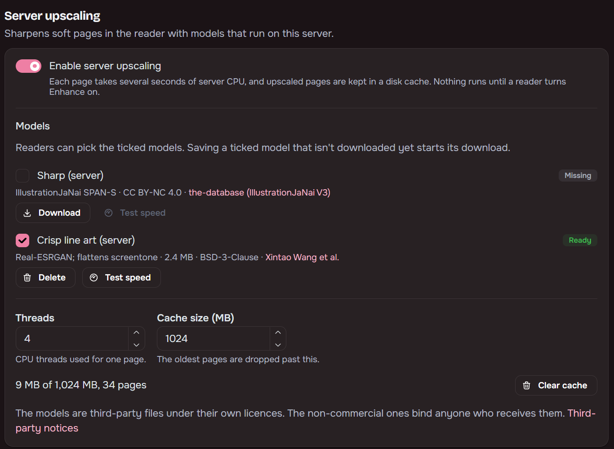

import ImageCompare from '../../../components/ImageCompare.astro';
import normal from '../../../assets/normal.png';
import upscaled from '../../../assets/upscaled.png';

Enhance sharpens soft, low-resolution pages in the built-in reader, which helps most on a large
screen. It is off until a reader turns it on. Library files are never modified.

<ImageCompare before={normal} after={upscaled} alt="Manga page" />

## Two tiers, one setting

- **Browser methods** (**Light**, **Balanced**, **Strong**) run Anime4K shaders on the reader's own
  device. They are always available and need WebGL2.
- **Server methods** (**Sharp (server)**, **Crisp line art (server)**) run ONNX models on the Maki
  server. They appear in the Method list once an admin has enabled them, and stay disabled, marked
  Downloading or Not available, until the model is ready. Sharp is IllustrationJaNai SPAN-S. Crisp
  line art is Real-ESRGAN animevideov3 and flattens screentone.

A greyscale page stays greyscale whichever method draws it.

## Turning it on

In the reader toolbar's settings popover, set **Enhance** to Off, Auto or Always and pick a
**Method**. The same two fields are in reading profiles and in per-series overrides, so they follow
the usual order: series override, pinned profile, type profile, your default.

**Auto** enhances a page when it is shown at least 1.2 times larger than its source on either side,
or when the page itself looks soft and blurry. A sharp page in a small window stays plain.

Hold **H** or the toolbar's compare button to see the original page.

**Don't enhance** skips chapters by file quality. Tick any of **Volume**, **Official**,
**Scanlator**, **Aggregator** or **Unknown**, and chapters whose file has that tier show the plain
page and never reach the server queue. It starts with **Volume** ticked. With nothing ticked, the
placeholder reads "Every quality is enhanced". The tiers are described under
[Source tiers](/Maki/guides/library/chapter-upgrades/#source-tiers).

## Server progress

While a server method is still working on the page on screen, a pill at the bottom says whether it
is waiting, upscaling or loading, and the fallback shows meanwhile. The page bar marks the pages
ahead that are already upscaled in light grey, like the buffered part of a video.

## Working ahead

Paged mode enhances the pages in the preload window. Continuous mode sizes its range by pixels
instead of pages, so a chapter of many short slices is enhanced well down the strip and one of a few
very tall slices only a page or two ahead, within what the device can hold. Near a chapter's end, a
server method also queues the next chapter's first pages, so it opens already upscaled.

## Fallbacks

A server method shows a browser method on this device while its page is not ready. The default is
**Balanced**. Choose **Light**, **Strong** or **None** (the plain page) under "While the server
works" in the reader settings, or "Fallback" in a reading profile.

The fallback stays on for good when the reader is offline, the admin tier is off or the model is not
downloaded. A device without WebGL2 shows plain pages, and the browser methods read "Not supported
on this device".

## Server upscaling (admins)

Settings, Library, **Server upscaling** has:

- the on switch and the list of models readers may use
- **Threads**
- the cache cap (1 GB by default) and **Clear cache**
- **Test speed**, which times one built-in sample page

Models are not bundled. Maki downloads each one from a Maki GitHub release when an admin ticks it
and saves, or from its Download button, and checks its SHA-256. Some are licensed for non-commercial use only; the per-model licences are in
[THIRD_PARTY_NOTICES.md](https://github.com/OrbitMPGH/Maki/blob/main/THIRD_PARTY_NOTICES.md).

A page takes seconds of server CPU, a few times longer on a NAS, so the queue is capped per reader
and shared fairly between readers.

## Privacy

Pages never leave your server or your device. The only outside traffic is model downloads from
GitHub, and those start only when an admin asks for a model. Upscaled pages are a disposable cache
under the config folder, oldest-used dropped first, and they can be cleared at any time.
