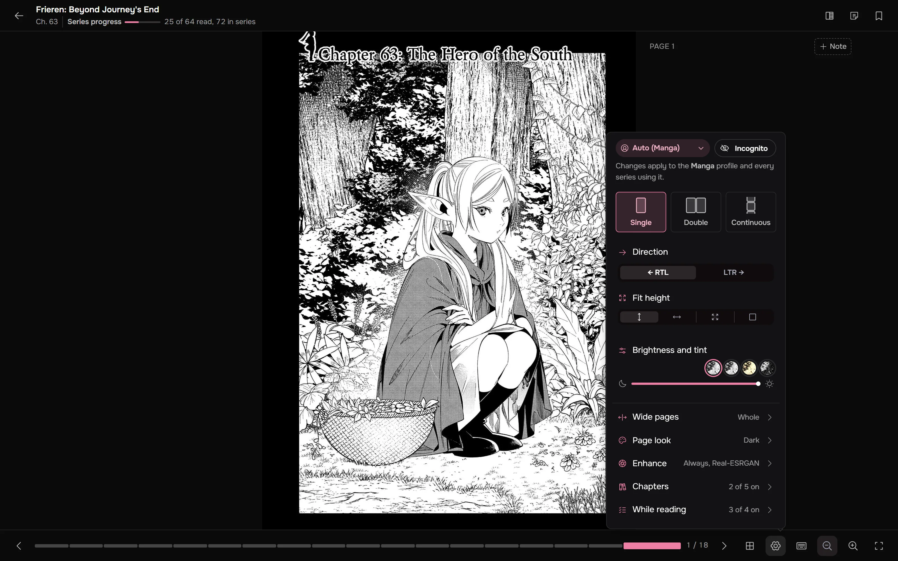
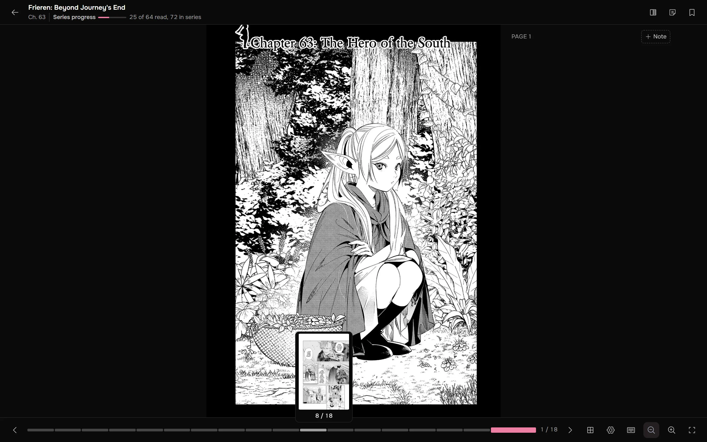
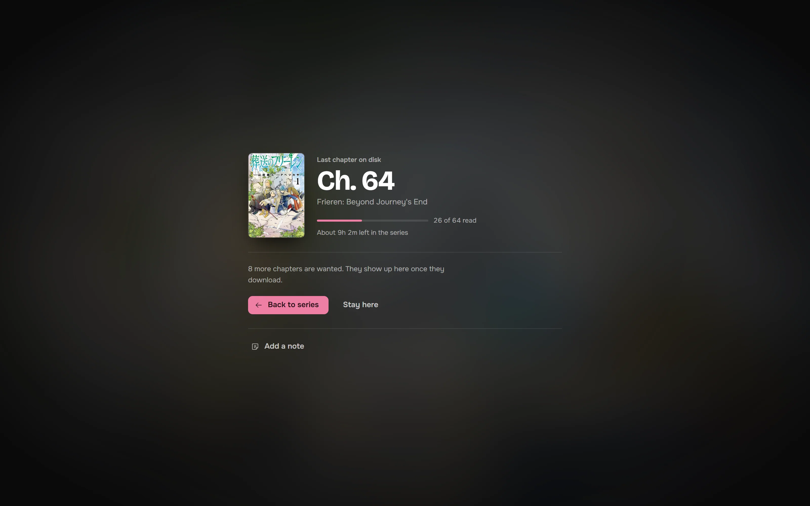
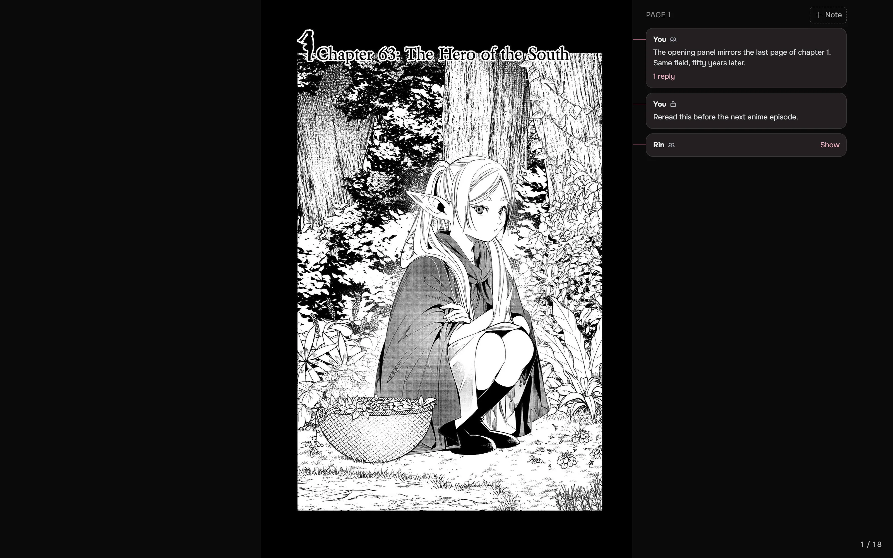
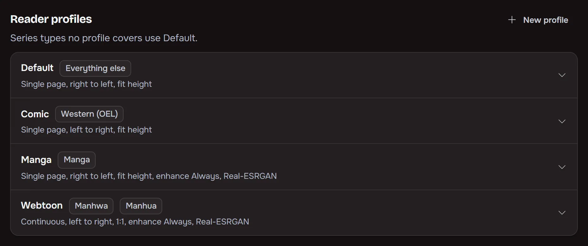
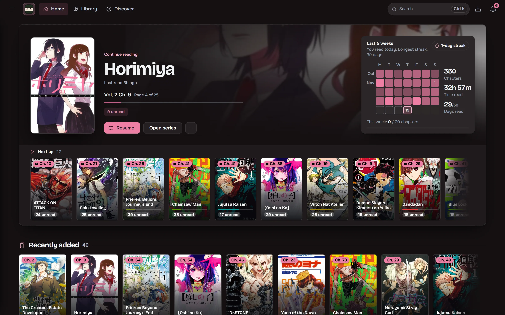
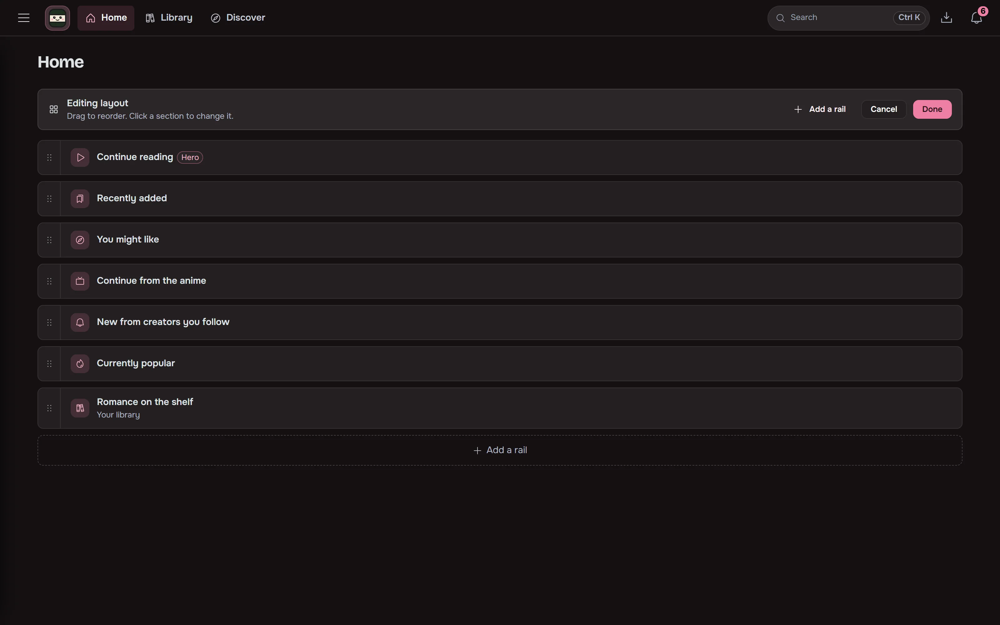

## Built-in reader

Single, double and continuous layouts, plus a 1:1 (original size) fit. Progress is tracked and merged
with Kavita so nothing double-counts. A read meter shows how far through the series you are. The
series page estimates time to finish from comparable chapters.

- Wide pages in single-page mode can be shown whole, split into two halves in reading order, or
  rotated.
- **Crop borders** (shortcut C) trims plain white or black margins.
- **Enhance** sharpens soft pages, with browser shaders or server upscaling. See
  [Page enhance](/Maki/features/page-enhance/).
- Chapters with very tall pages open in continuous mode on their own.
- In continuous mode, scrolling past the end of a chapter opens the next one. On touch, pull past
  the end instead.
- Continuous mode also moves a screen at a time with a tap on the top or bottom of the screen, or
  with `Space`, `Page Down` and `Page Up`. Auto-scroll (`A`) has ten speeds and pauses while you
  touch the screen.
- The gear opens a quick settings panel that says what a change applies to: a profile and every
  series using it, this series, or your defaults.
- The page bar has one segment per page, lit up to the page on screen. Hover a segment for that
  page's thumbnail, and click or drag to jump. Bookmarked pages are flagged on it, and `,` and `.`
  jump to the previous and next bookmark.

  

- In the Single and Double layouts, pinch to zoom around the point between your fingers (or use
  Ctrl and the scroll wheel, or a trackpad pinch), swipe sideways to turn the page, and use the
  scroll wheel to turn pages too. Double-tap zooms in on the spot you tapped.
- Tap zones come in four layouts: Sides, L-shape, Kindle and Edges. Their size can be changed and
  back and forward swapped, and they are drawn on the page while you adjust them.
- **Hide credit pages** leaves out scanlator credit, recruitment, donation and notice pages at the
  start and end of a chapter. Maki finds pages that repeat at the same edge of nearby chapters and
  reads their text, so copyright pages, title pages and covers stay. Your files are never changed.
- **Skip recap**: webtoon chapters that open by repeating the end of the previous one get a button
  in Continuous layout that jumps to where the new pages start, or skip it automatically.
- Continuous mode can show a progress rail down the right edge that you drag with the bars up.
- Page backgrounds: dark, OLED black, white, grey and Auto, which takes the colour of the page's edge.
- The end of a chapter does more. On the last chapter of a series you have finished, it asks for
  your final rating. It shows about how much reading time is left in the series at your pace, and
  when you are caught up, a rough span for the next chapter, such as "usually comes in 1 to 2
  weeks", never a date.

## Chapter notes

Write a note on any page while you read. Keep it private or share it with everyone who can see the
series, and reply to other readers' shared notes. On wide screens notes sit in the margin beside
their page, and other people's notes stay folded until you finish the chapter. See
[Chapter notes](/Maki/guides/reading/chapter-notes/).

## Reading profiles

Per-user defaults for page fit, direction and mode by series type, with per-series overrides on top.

## Home

Opens on one large card for the series you read last, with the rest of **Continue reading** in a
**Next up** tray under it, and a **Your last five weeks** card with reading days, streak and goal
progress.

Continue reading lists every series with something left to read, most recently read first, whether
you stopped part-way through a chapter or between two. Series you put On hold or Dropped leave it
until you read them again. **Recently added**, **You might like** and
the other rails follow, and a library rail can show one of your saved Library filters. Every part can be reordered or switched off per user in the layout editor.

## Install as an app and read offline

Maki installs to a phone or desktop home screen. Save chapters or whole series to the device, or let
it keep the next few unread chapters of what you're reading. Library and series pages you have
visited still open offline, and progress read offline syncs when the connection returns. Push
notifications can announce new chapters. See [Offline reading](/Maki/guides/reading/offline-and-app/).
