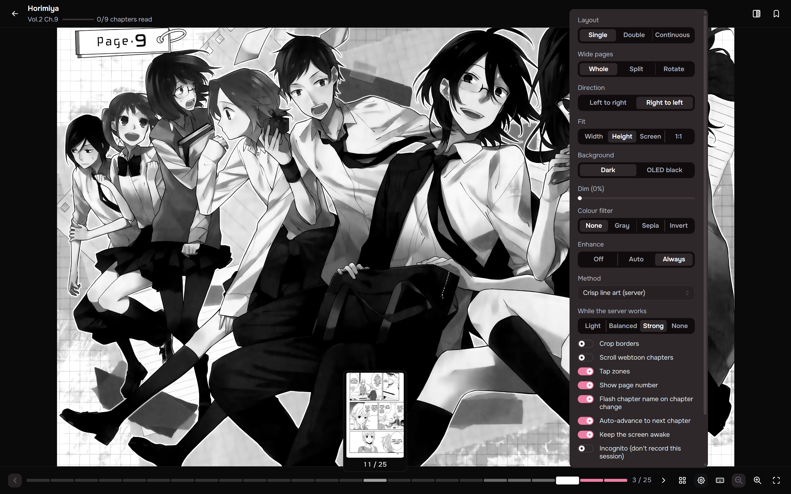
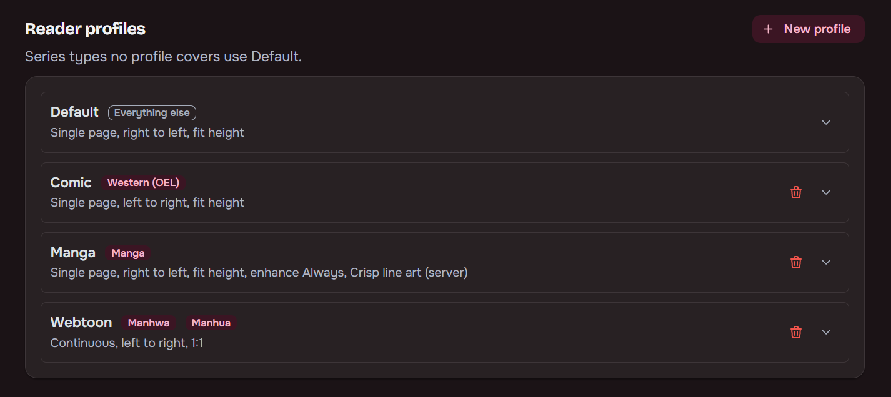
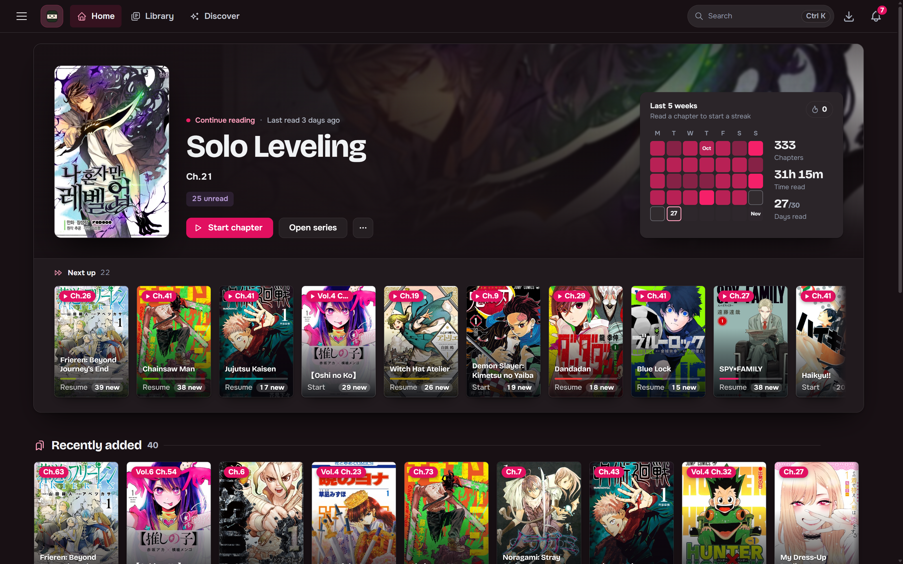

## Built-in reader

Single, double and continuous layouts, plus a 1:1 (original size) fit. Progress is tracked and merged
with Kavita so nothing double-counts. A read meter shows how far through the series you are. The
series page estimates time to finish from comparable chapters.

- Wide pages in single-page mode can be shown whole, split into two halves in reading order, or
  rotated.
- **Crop borders** (shortcut C) trims plain white or black margins.
- **Enhance** sharpens soft pages, with browser shaders or server upscaling. See
  [Page enhance](/Maki/features/page-enhance/).
- Chapters with very tall pages open in continuous mode on their own.
- In continuous mode, scrolling past the end of a chapter opens the next one. On touch, pull past
  the end instead.
- The page bar has one segment per page, lit up to the page on screen. Hover a segment for that
  page's thumbnail, and click or drag to jump.

## Reading profiles

Per-user defaults for page fit, direction and mode by series type, with per-series overrides on top.

## Home

Opens on one large card for the series you read last, with the rest of **Continue reading** in a
**Next up** tray under it, and a **Your last five weeks** card with reading days, streak and goal
progress.

Continue reading lists every series with something left to read, most recently read first, whether
you stopped part-way through a chapter or between two. **Recently added**, **You might like** and
the other rails follow. Every part can be reordered or switched off per user in the layout editor.

## Install as an app and read offline

Maki installs to a phone or desktop home screen. Save chapters or whole series to the device, or let
it keep the next few unread chapters of what you're reading. Library and series pages you have
visited still open offline, and progress read offline syncs when the connection returns. Push
notifications can announce new chapters. See [Offline reading](/Maki/guides/reading/offline-and-app/).
