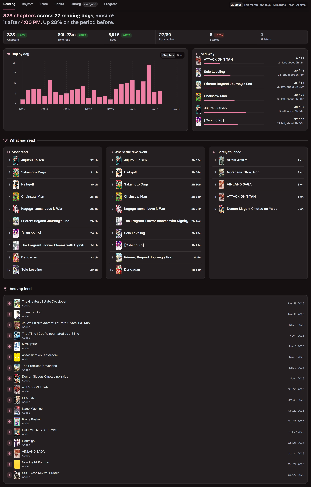
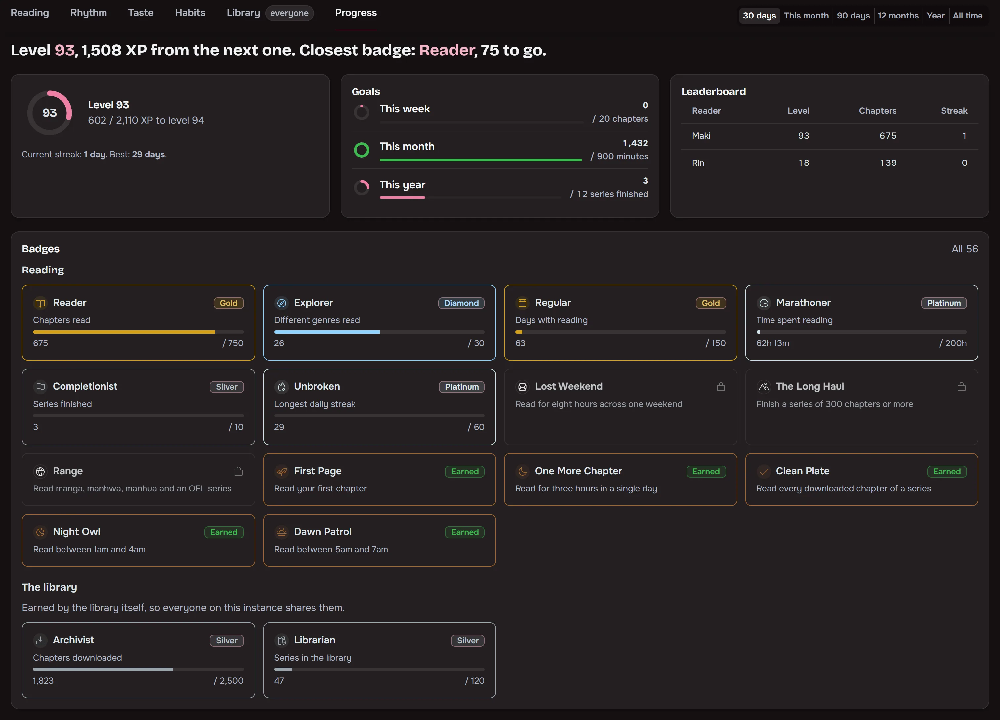

## History

Reading, Rhythm, Taste and Habits, built from an append-only history of reading and downloads:
per-series read counts, activity over time and so on. Library covers the whole instance.

## Progress

Levels, goals, badges and a leaderboard. The leaderboard is hidden in single-user mode. Series
marked Full incognito never generate events, and series marked No scrobble still count in Stats.

- Reading a finished series again from the start counts as another series finished, in stats, goals
  and achievements. Marking only the last chapter unread and reading it again does not.
- A secret achievement counts toward the badge total only once you earn it.
- The first time progress is worked out for an account, and after you switch progress tracking back
  on, achievements earned up to then are added quietly. Only new ones send a notification.
- Someone who switched streaks off has no streak on the leaderboard, and the Streak column is hidden
  for you when your own streaks are off.
- The Dropped list in Stats and Rewind shows the series you set to Dropped.
