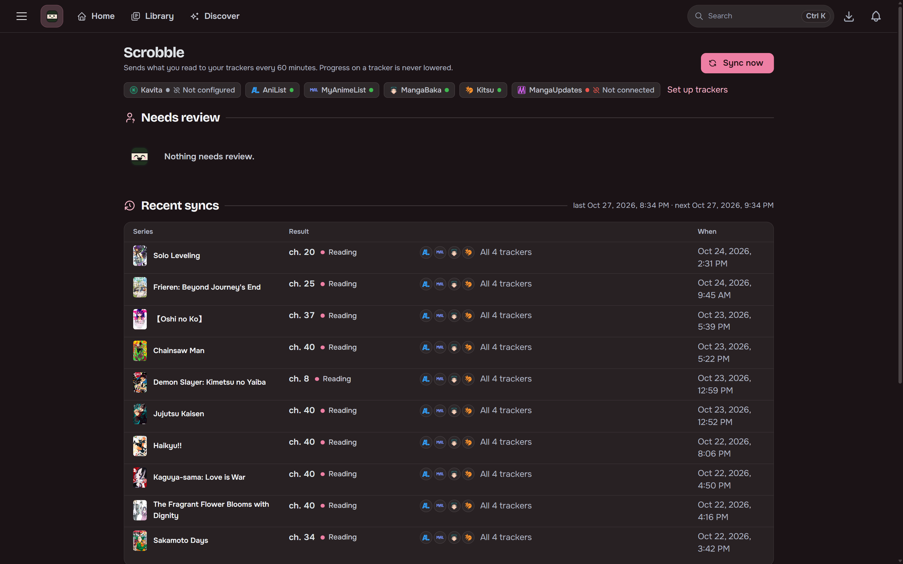
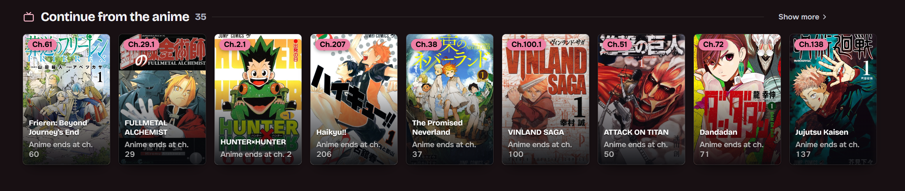
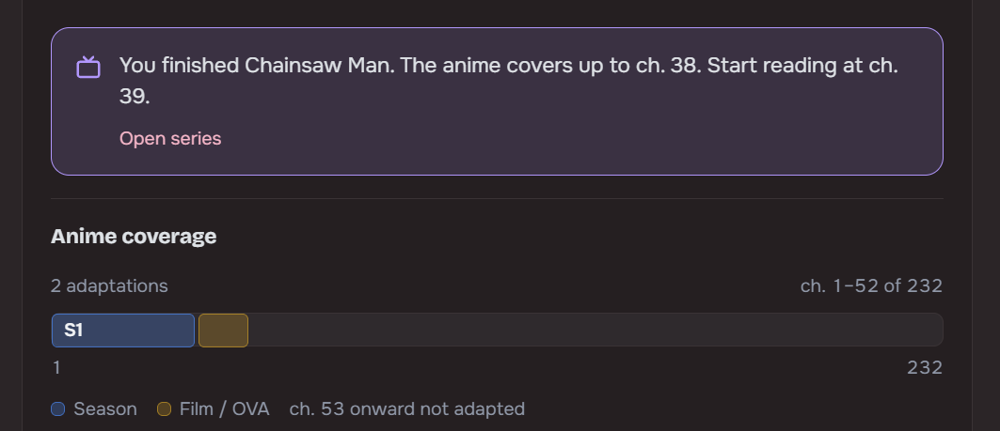

## Scrobbling

Sends read progress to AniList, MyAnimeList, Kitsu, MangaBaka and MangaUpdates, whether the reading
happened in Maki, over OPDS, in KOReader or in Kavita. Your lists on those trackers can also be
imported into the library from Settings.

## Anime tie-in

For a series with an anime adaptation, Maki can start you at the chapter where the anime ended.

## Ratings

Rate a series from 1 to 10 when you finish it, or set a "so far" score while you are partway through.
Maki asks how a series is going at a few points while you read. Final ratings can be sent to your
trackers, and "so far" scores only when you turn that on. See
[Ratings and "so far" scores](/Maki/guides/trackers/ratings/).
