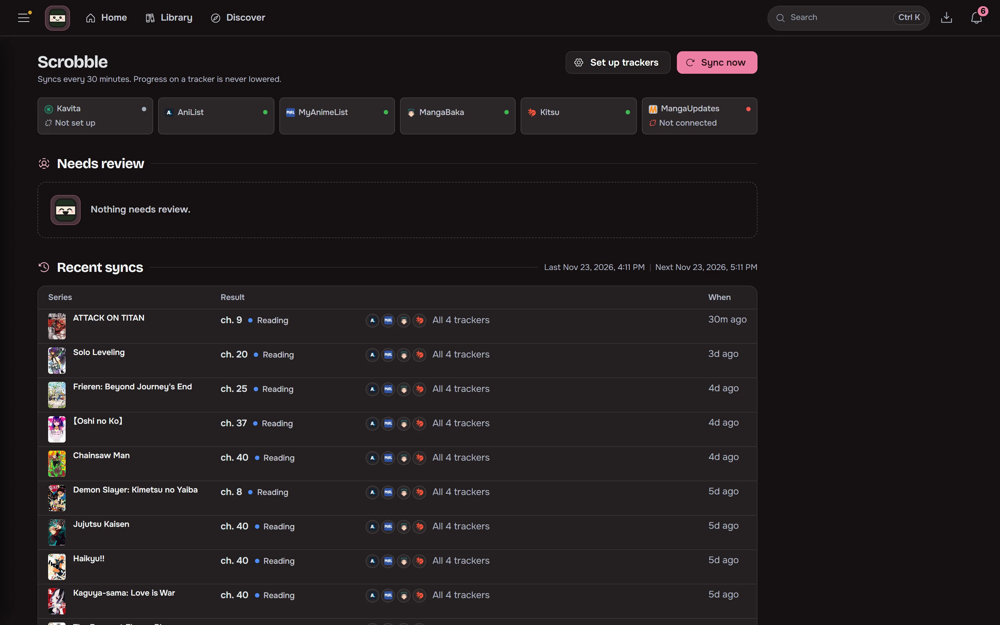
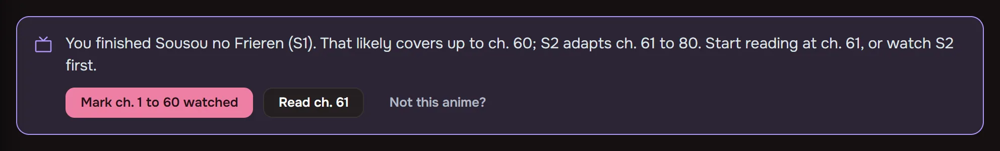
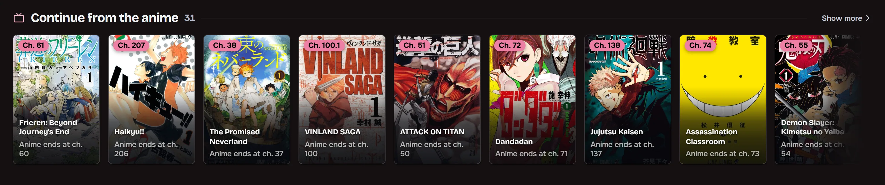
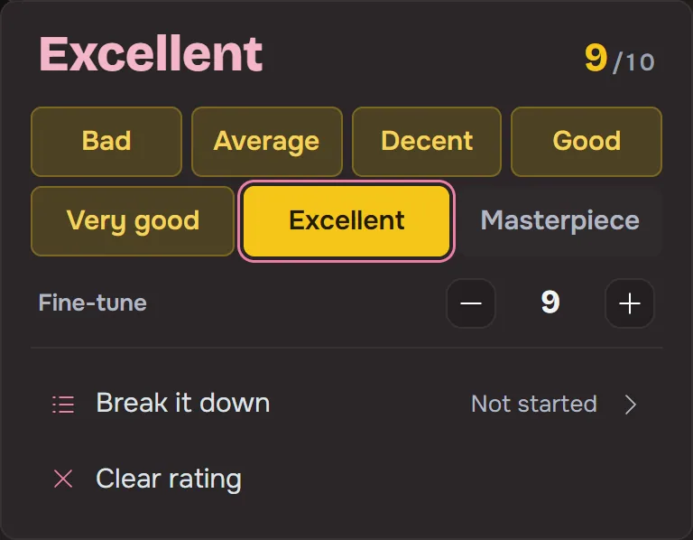

## Scrobbling

Sends read progress to AniList, MyAnimeList, Kitsu, MangaBaka and MangaUpdates, whether the reading
happened in Maki, over OPDS, in KOReader or in Kavita. Your lists on those trackers can also be
imported into the library from Settings.

## Anime tie-in

For a series with an anime adaptation, Maki can start you at the chapter where the anime ended.

Home's **Continue from the anime** rail lists those series, your most recent tracker updates first,
and skips series the anime has fully caught up with. Dismiss a card, with undo, either until a new
season moves past the chapters it covers or for good.

## Ratings

Rate a series from 1 to 10 when you finish it, or set a "so far" score while you are partway through.
Maki asks how a series is going at a few points while you read. Final ratings can be sent to your
trackers, and "so far" scores only when you turn that on. See
[Ratings and "so far" scores](/Maki/guides/trackers/ratings/).

