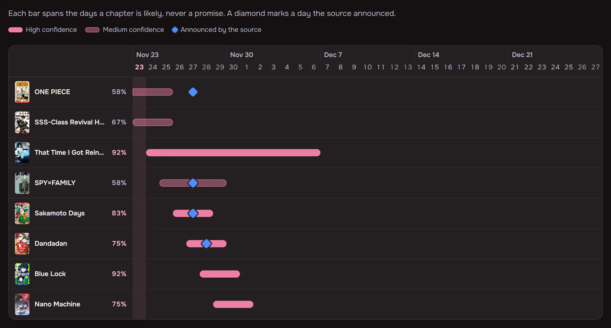
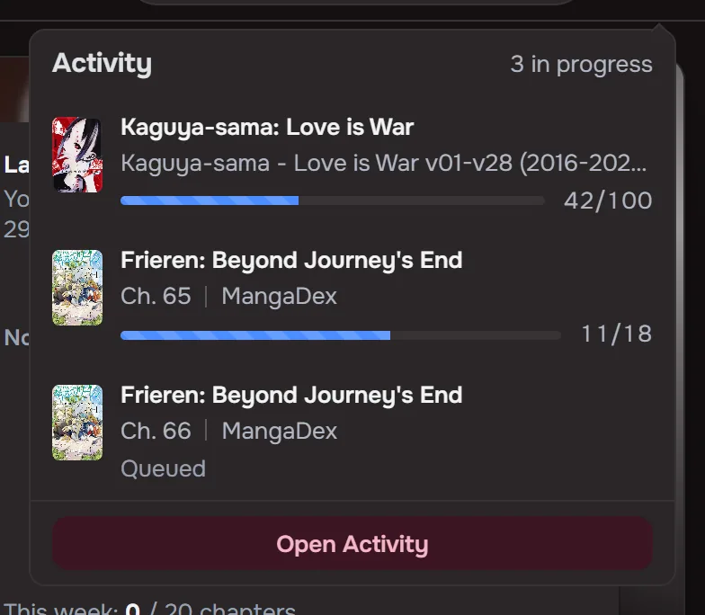
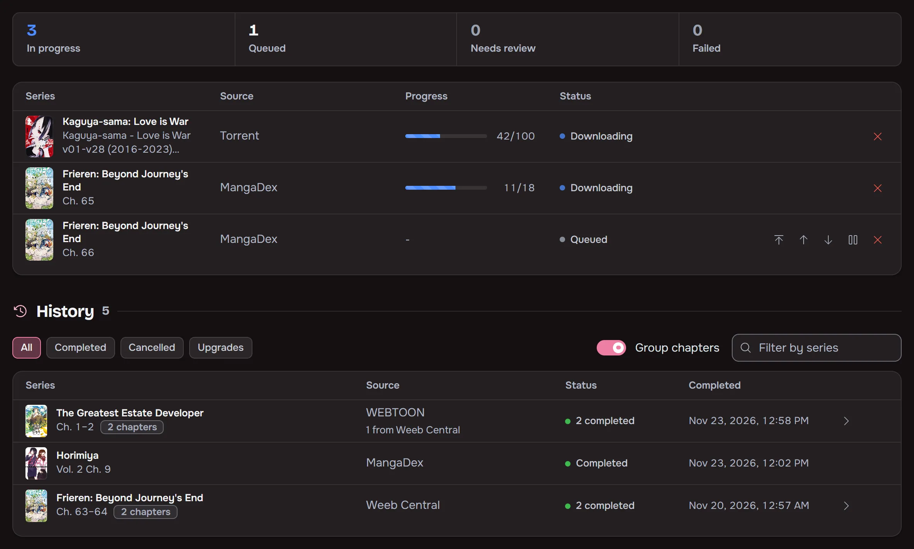
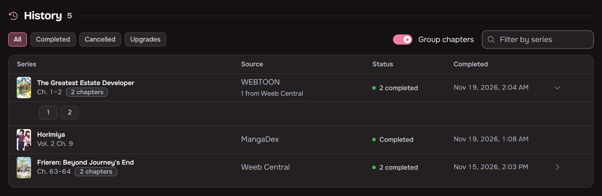
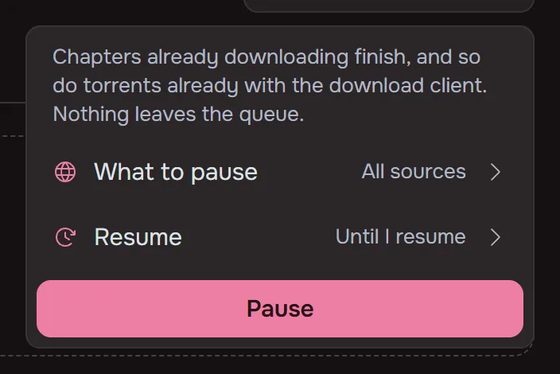
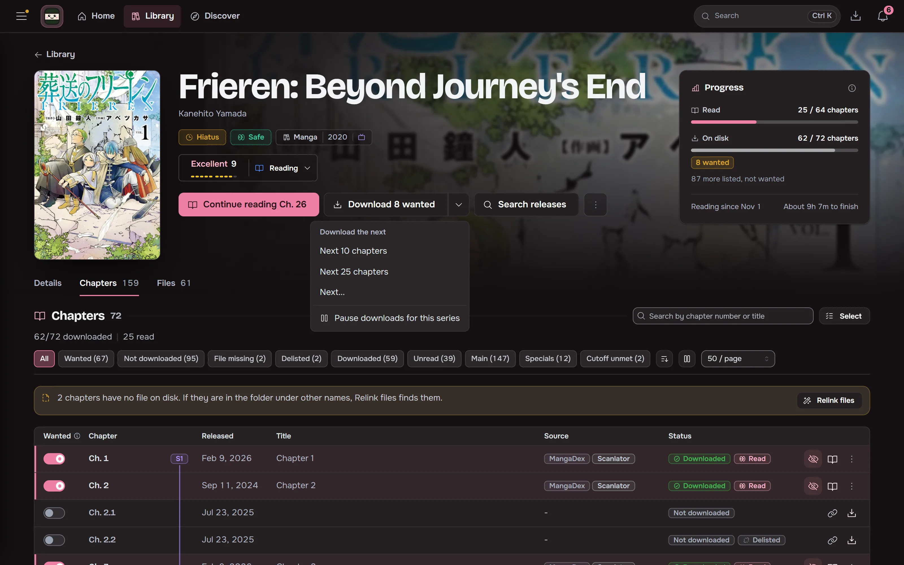

## Activity

The **Activity** page (`/activity`) has three tabs.

- **Queue** lists downloads that are waiting, running or need a decision. The counters on top show
  **In progress**, **Queued**, **Needs review** and **Failed**.
- **Upgrades** lists files that fall short of the quality cutoff in their profile. When none do, it
  says **Every file meets its cutoff**. Volume releases waiting for you are listed first. Each
  recent upgrade has a **Revert this upgrade** button while its replaced file is still in the trash.
- **Upcoming** shows each series' likely next chapter on a five-week grid, as a span with a
  confidence, not a date. A release time that a source announces appears on its day.

The **Activity** button in the top bar shows how many downloads are in progress, or how many are
waiting for an import decision, which takes priority. Select it to open a dropdown of up to eight
downloads with an **Open Activity** button below them. Rows waiting for an import decision come
first. With nothing in flight, the button opens this page directly.

The queue updates live. Each row can be moved to the top, moved up or down, retried or
removed. Rows in **Needs review** also get a **Review** button. **Clear queue** removes everything
still pending and cancels downloads in progress.

New chapters do not wait behind a big backlog. Chapters found by the monitored refresh, Smart
top-ups and a single chapter you click download first, then everything else, and **Download all**,
other bulk downloads and upgrades come last. When you read close to the last chapter on disk, that
series' next three queued chapters move to the front. Moving a row to the top puts it first, and
moving it past another kind of download makes it that kind.

**Time left** gives a rough guess of how long the queue has left, overall and for each series, from
how fast each source has been downloading lately. It stays hidden until there is enough download
history, and paused or held downloads are left out.

Some rows wait instead of downloading:

- **Waiting for release**: the chapter is still early access on its source. If another linked
  source already has it free, Maki takes it from there instead. Otherwise the row shows the time of
  the next check and downloads on its own once the source releases it. It does not count as a
  failure, and **Retry failed** and **Remove failed** leave it alone.
- **Waiting for disk space**: the root folder's drive is below the free space it keeps (5 GB by
  default, under **Settings → Library → Root folders**). Other folders keep downloading.

Finished and cancelled downloads move to **History** below the queue. A batch of chapters from one
series folds into one row, such as "Ch. 109–119, 11 chapters". Open the row to see each chapter as a
chip that opens it in the reader; a dashed chip came from a different source. Filter the history by
**Completed**, **Cancelled** or **Upgrades**, search it by series, or turn off **Group chapters** for
one row per chapter.

A long queue shows only the first items. A line under the table gives the total, and the rest
still download.

### Pausing downloads

**Pause downloads** stops new items from starting. Pick all sources or one source, and a duration:
**Until I resume**, **For 1 hour**, **Until tomorrow morning** or **Until a time I choose**. Queue
rows are untouched and downloads already in progress finish.

To pause one series without pausing anything else, use the pause button on its rows in Activity, or
**Pause downloads for this series** in the download menu on its series page. Its chapters stay in
the queue and pick up where they left off when you resume.

## Wanted

Every chapter has a **Wanted** flag that records whether you want a file for it.

Maki sets the flag when it first finds a chapter, based on the series' monitor setting: **All
chapters**, **Smart**, **Main only, no specials**, or **None**. Smart keeps new chapters wanted and
queues them a batch at a time, ahead of where you are reading. A monitor setting only affects
chapters released after you change it.

On a series page, filter the chapter list to **Wanted (N)** (or use the **Wanted** column), and
select chapters to choose **Want** or **Don't want**. Unwanted chapters are skipped by every
download that queues "all wanted" chapters, and by Smart.

The **Clean up read chapters** card under **Settings → Downloads** can delete a file you have
finished. Its chapter stays listed as removed and is not downloaded again unless you turn **Wanted**
back on.

## Downloading what is missing

On a series page, **Download N wanted** (N is the number of wanted chapters without a file) queues
every missing chapter Maki can find. It is hidden when every wanted chapter is on disk. With 50 or
more missing, Maki asks you to confirm first.

The menu next to it has **Download the next**: the next 10 or 25 chapters, or a count you type
under **Next...**. They are queued in chapter order from the lowest missing number, and the rest
stay wanted.

With **Look for volume releases first** on, a new series waits for its volume release search before
downloading chapter by chapter. The series page says what is waiting and has **Download from sources
now**, and **Download N wanted** mentions a pending volume release and lets you grab it instead. See
[Torrents](/Maki/guides/sources/torrents/#volume-releases-first).

In the library, select series and choose **Search missing** from the bulk actions to search for
each one. It only appears if your account may download chapters.
