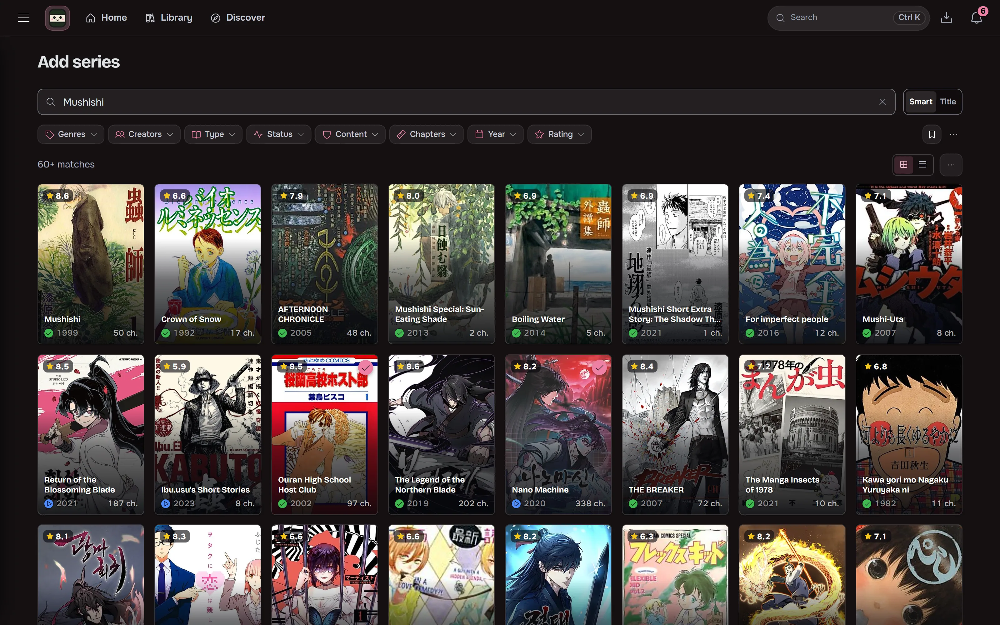
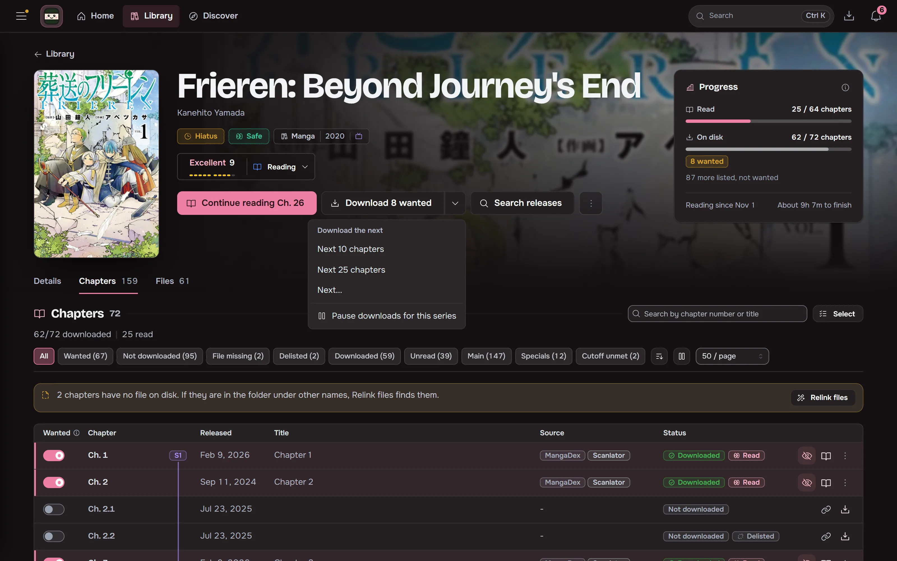

1. Click **Add series**, search for a title and pick it. Maki links sources and syncs chapters in the
   background.

   

2. Open the series. Download a chapter, or click **Download N wanted**, where N is the number of
   wanted chapters you don't have yet, to queue them.

   

3. Follow progress under **Activity**. See [Activity and the queue](/Maki/guides/getting-started/activity-and-queue/).

If a source you want needs Cloudflare solving, set up FlareSolverr first. See
[Kavita, FlareSolverr and Suwayomi](/Maki/installation/companions/).

## Already have a library?

The Import page can bring in an existing folder of CBZ files, single files from anywhere on the
server (**Manual import**) and a Mihon backup (`.tachibk` or `.proto.gz`). A drop folder under
**Settings → Library** imports files that land in it on their own. See
[Import an existing library](/Maki/guides/getting-started/import-existing-library/)
and [Import a Mihon backup](/Maki/guides/getting-started/import-mihon-backup/).

## Next

- [Choose sources](/Maki/guides/sources/choosing-sources/)
- [Read in your favourite app](/Maki/guides/reading/opds-apps/)
