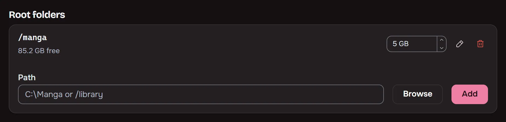
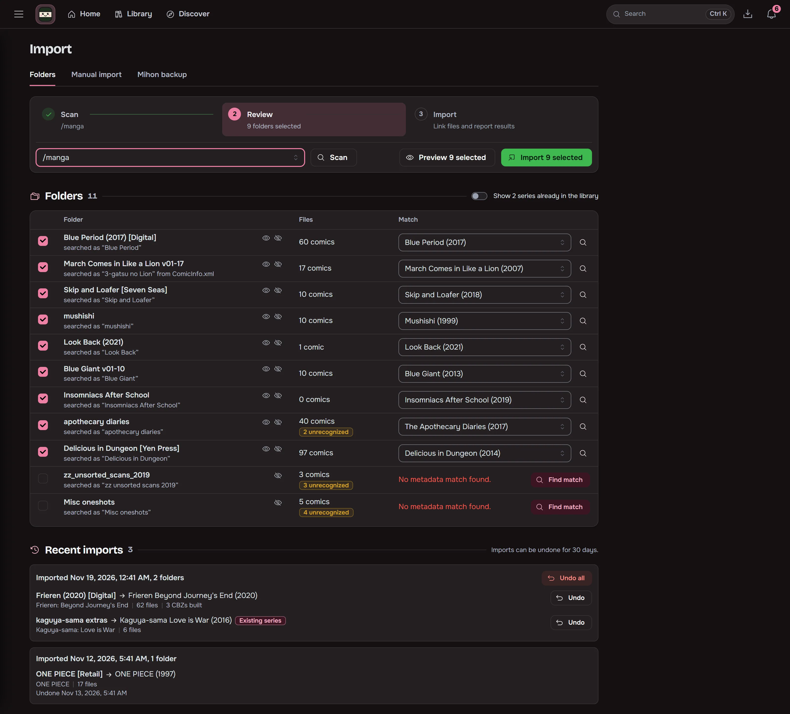
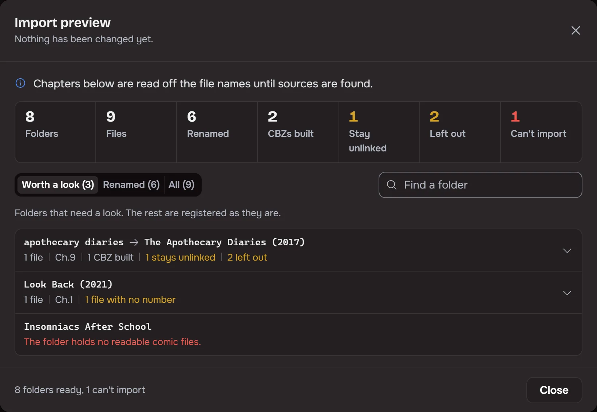
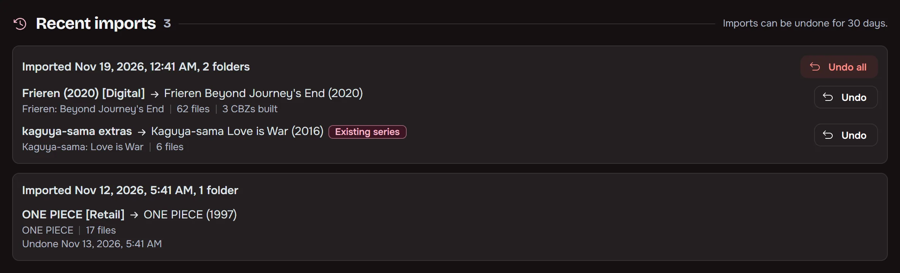
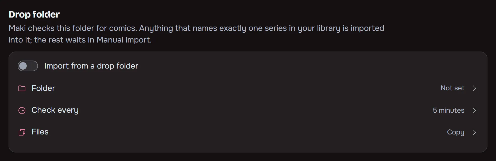

Use the **Import** page to bring comics you already have in folders, such as a Kavita or Komga
library, under Maki. Import reads the folders on disk, not the Kavita or Komga database. This page
covers the **Folders** tab. For single files from anywhere on the server, see
[Manual import](#manual-import), and for files that arrive on their own, [Drop folder](#drop-folder).

Before you start:

- Add the library folder as a root folder under **Settings → Library → Root folders**. Pick it with
  **Browse**, then click **Add**.
- Install the local MangaBaka database, which the matching uses.

## Scan a root folder

1. Open **Import** and pick the root folder.
2. Click **Scan**. Maki lists each folder that holds comics. Folders with no comics are skipped.

Maki also looks inside grouping folders such as `A-Z/` or a publisher folder, up to two levels deep,
and lists the series folders it finds there. Importing one moves it up to the root folder. Comics
sitting loose in the root folder are grouped by series into rows of their own. They are moved into a
new folder only when you import them, and undoing the import puts them back.

Folders you ignored stay out of the list. The button above the list shows how many there are and
opens **Ignored folders**, where you can bring one back and scan again.

## How folders are matched

Maki first reads the ComicInfo.xml in the folder's first CBZ, and a Mylar `series.json` beside the
files. A MangaBaka, AniList, MyAnimeList or MangaUpdates link in ComicInfo matches that exact
series, and a series name in either file is searched before the folder name. Otherwise Maki strips
release tags such as group names from the folder name and searches the local MangaBaka database. It
lists up to five matches and picks the first for a folder that is not in your library yet. Each row
says what found its match.

- To choose another match, open the folder's match menu. Use **Find match** to search by title, or
  paste an id: a MangaBaka id or link, or an AniList or MyAnimeList link or id.
- Choose **- skip -** to leave a folder out.
- A folder whose series is already in your library shows **In library**. Importing it links its
  files into that series, so the missing chapters fill in.
- A folder for an archived series is a restore. Importing it brings the series back.

If nothing matches, the folder says **No metadata match found.** Use **Find match** or skip it.

## Import

Select the folders and click **Import N selected**. The confirmation dialog has a checkbox,
**Standardize ComicInfo.xml inside the imported files (recommended)**, which helps Kavita group these
files with later downloads. **Preview N selected** shows what the import would do for the
selected folders before anything is written. The preview button on a single folder does the same
for that folder.

The preview lists each folder on one line, and a folder opens onto its files when you select it.
With 8 or more folders it opens on a summary, and a list you can filter with **Worth a look**,
**Renamed** or **All**, or search with **Find a folder**.

The dialog says folders are renamed to the English title, but the real behaviour comes from
**Settings → Library → Folder & file naming → Folder naming on import**:

- **Rename the folder to the series folder format.** This is the default.
- **Keep the folder name, but put new downloads in a folder named by the format.**
- **Keep the folder name, and put new downloads there too.**

Comics that are not CBZ, such as RAR or zip archives or a folder of loose images, are converted to
CBZ. Your originals stay where they are. PDFs are kept as they are and read in place.

## After the import

The import returns at once. Maki then searches the sources for each series in the background and
links your files to their chapters. Until that finishes, a folder reads **added N files, linking
once sources are found**. A file whose chapter number Maki cannot read is reported as unrecognized,
and a file that matches no chapter becomes a chapter of its own.

Every import is listed under **Recent imports** with **Undo this import**, available for 30 days.
Undo removes a series only when the import created it and nothing has been downloaded or read
since. It never deletes your original files.

## Manual import

The **Manual import** tab on the Import page is for single files or folders that are not laid out as
series folders. Browse to a folder or file on the server, check the chapter and volume Maki reads
from each file, pick the series it belongs to and import it. The review shows which chapters each
file brings and which existing files it would replace, and you choose to copy (or hardlink) the
files or move them.

Admins can browse anywhere on the server. Other users need the **Import library** permission and
can only browse inside their own root folders. Manual imports show up in the Activity history.

## Drop folder

An admin sets a drop folder under **Settings → Library → Drop folder**, and Maki checks it every few
minutes (five by default).
A comic or folder whose ComicInfo link or name matches exactly one series in your library is imported
into that series once its size has stopped changing, copied or moved as you choose. Nothing already
in the library is replaced. Anything that matches no series, or more than one, stays where it is and
is listed on the **Manual import** tab for you to place by hand. In Docker, a drop folder outside
`/library` needs its own mount. See [Volumes and permissions](/Maki/installation/volumes-and-permissions/#a-drop-folder).

:::tip
If Kavita shares this folder, see [Kavita alongside Maki](/Maki/guides/reading/kavita/) for how
Maki and Kavita keep each other up to date.
:::
