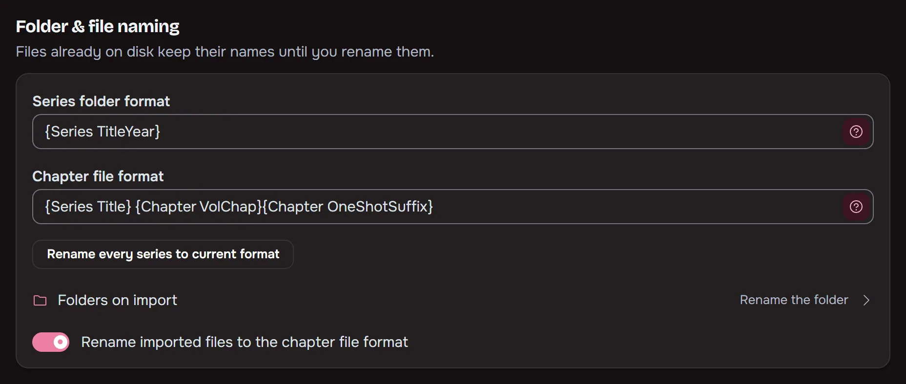
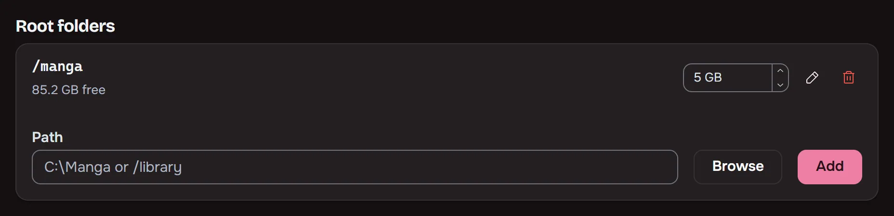

Naming is set in **Settings, Library, Folder & file naming**.



## Root folders

A root folder is a directory on the server that Maki owns for its library. Every series lives in one
root folder, and every stored file path is relative to it. Manage them in **Settings, Library, Root
folders**. Access is granted per user under **Settings, Users**, so someone with no grants sees an
empty library.

Maki keeps `.maki-trash/` (deleted and replaced files) and `.maki/tmp` (work in progress) inside each
root folder. Imports and health scans skip folders starting with a dot.

Each root folder keeps 5 GB free by default (**Free space to keep**, 0 turns it off). When its drive
drops below that, downloads and torrent grabs for series in that folder wait, other folders keep
going, and everything carries on once there is room again. Activity says which folder is held.



If a share is re-mounted or the library moves to new storage, use the root folder's edit button
rather than adding a new one. It checks the new path and counts the series folders there before
saving. Files are not moved, and it waits while a download, import, bulk move, page conversion or
health scan is running in that folder.

### Root folder rules

**Settings, Library, Root folder rules** sends a new series to the right root folder by its type, genre, content rating, who added it or how it came in, for example every
manhwa and manhua to a webtoon folder. Rules are tried in order and the first match wins. With no
match a series goes to the first root folder. The add form and the request approval dialog open on
the folder a rule picked, and you can still change it. Import lists without a chosen folder and
Mihon imports use the rules too. Library imports and series already in the library are never moved.

## Series folders

A series gets one folder under its root. The default format, `{Series TitleYear}`, gives folders like
`Berserk (1989)`. The year tells apart remakes that share a title, and is left out when unknown.

Each series remembers the folder it was created with. Changing **Series folder format** affects new
series only, and existing series keep downloading into their stored folder.

## Chapter files

The default chapter format is `{Series Title} {Chapter VolChap}{Chapter OneShotSuffix}`. It gives:

- `Berserk Vol.3 Ch.24.cbz`
- `One Punch Man Ch.10.5.cbz`
- `Look Back.cbz` (a one-shot with no chapter number)
- `Series - One-shot Title.cbz` (a one-shot that has a title)

Maki adds `.cbz` itself, and a format cannot change it.

Chapters in a language other than English get ` [xx]` after the name, such as `[es]`, unless the
format already has a `{Chapter Language}` token. Otherwise two languages of the same chapter would
write to the same file name.

A file that holds several chapters, such as a volume compilation, is named for the whole span:
`Vol.1` when it holds every known chapter of that volume, `Vol.1 Ch.1-3` for part of a volume, and
`Ch.1-6` when there is no volume information.

### Tokens

- Series: `{Series Title}`, `{Series TitleYear}`, `{Series CleanTitle}`, `{Series SortTitle}`,
  `{Series OriginalTitle}`, `{Series Year}`, `{Series Type}`, `{Series Status}`, `{Series Author}`,
  `{Series Publisher}`
- Chapter: `{Chapter VolChap}`, `{Chapter Number}`, `{Chapter Volume}`, `{Chapter Title}`,
  `{Chapter OneShotSuffix}`, `{Chapter Language}`, `{Chapter Group}`, `{Chapter Source}`,
  `{Chapter ReleaseDate}`, `{Quality Tier}`
- Provider ids: `{MangaBakaId}`, `{MalId}`, `{AniListId}`, `{MangaDexId}`, `{MangaUpdatesId}`,
  `{KitsuId}`

Empty tokens print nothing, and Maki tidies leftover spaces and empty brackets.

### Optional parts

Wrap part of a format in `<` and `>` to keep it only when every token inside has a value. If any of
them is empty, the whole part is left out, text included. For example, `{Series Title} <({Chapter Group})>`
gives `Berserk (Band of the Hawk)` for a chapter with a group and just `Berserk` for one without.

Several optional parts can sit side by side, but they can't be nested, and the format needs at least
one token outside them so a name never comes out empty:

```
{Series Title} - <Vol. {Chapter Volume:00} ><Ch. {Chapter Number:0000}>
```

## Characters and length

Maki removes `< > : " / \ | ? *` and control characters from every name, and gives Windows reserved
names such as `CON` an underscore. A name over 200 bytes is shortened: Maki keeps the start and end
with a short hash in the middle, so two long titles stay distinct.

## Changing a format

Saving a new format moves nothing. Existing files keep their names until you use **Rename every
series to current format** on the same card. Maki refuses to rename a series while a download for it
is running, or when two chapters would end up with the same name.

## Folder naming on import

When Maki imports a series folder that already exists, **Folder naming on import** decides what
happens:

- **Rename the folder to the series folder format.** The default.
- **Keep the folder name, but put new downloads in a folder named by the format.** Old files stay
  put and new chapters go into a second folder, so one series can span two folders under the same
  root.
- **Keep the folder name, and put new downloads there too.**

:::tip
Pick a format before you import a large library. Renaming later works, but it touches every file.
:::
