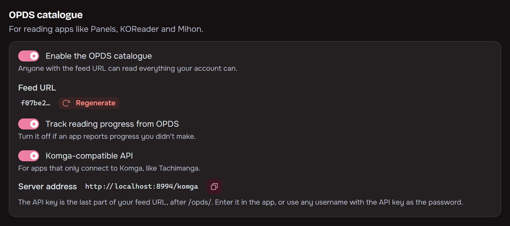

Maki serves a Komga-compatible API for apps that can only connect to a Komga server. Apps that read
OPDS feeds, such as Panels, Chunky, KOReader and Mihon's OPDS source, use the feed instead. See
[Reading over OPDS](/Maki/guides/reading/opds-apps/).

## Turn it on

In **Settings → Reading → OPDS catalogue**, turn on **Enable the OPDS catalogue**. The first time
you do, confirm your password (an account that signs in only through single sign-on needs a sign-in
from the last ten minutes instead), then turn on **Komga-compatible API**. Both must stay on for the API
to answer.

The card shows the two values an app needs:

- **Server address**, for example `http://your-host:8990/komga`.
- **API key**, which is your OPDS token, the last part of the feed URL after `/opds/`. It is shown
  only right after you enable the catalogue or regenerate the token. If you miss it, regenerate for a
  new one.

## Connect the app

Enter the server address and the API key. If the app asks for a username and password instead, use
any username and the API key as the password.

- Regenerating the OPDS token signs these apps out, so they need the new key.
- Turning off either switch stops them from connecting.
- API keys with full access do not open this API. Use the OPDS token.
- Archived series are left out of the API. See
  [Archiving a series](/Maki/guides/library/archiving/).

## Progress

Apps report progress to Maki, and Maki reports read state back. Mihon's Komga tracker and Komga
clients that track reading do this. The progress goes through the same path as the built-in reader,
so it counts in Stats and reaches your trackers and Kavita. For the full picture, see
[How progress syncs between apps](/Maki/guides/reading/progress-sync/).

- A single chapter the app reports as read counts as a read.
- A jump over several chapters marks them read in one go, so it does not show up as a day's reading
  in Rewind.
- A DELETE on a book or a series marks its chapters unread. A PATCH with `completed: false` never does.

Loading a page does not count as progress here, unlike OPDS.

The app's on-deck shelf leaves out series you put On hold or Dropped, until you read them again.

## Formats an app cannot show

Apps that cannot decode WebP or AVIF can ask for JPEG or PNG instead, as with Komga. Maki converts
the page for that request, which uses server CPU. JPEG XL pages always go out as WebP, and the API
lists them as WebP.

:::tip
AVIF pages do not open in KOReader or on iOS. If you read on those, keep page conversion on a format
they can open. See [Page conversion](/Maki/guides/library/page-conversion/).
:::
