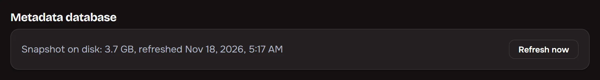
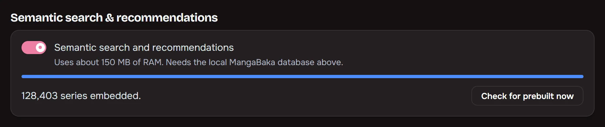

Maki keeps two local datasets so search, metadata and recommendations work without calling an outside
service per request: a copy of the [MangaBaka](https://mangabaka.org) database, and an index of
vectors built from it. Both are built from public catalogue data, and nothing about your reading is
sent to MangaBaka unless you connect it as a tracker. For how recommendations use them, see
[How recommendations work](/Maki/guides/recommendations/how-it-works/).

## The MangaBaka database

The snapshot is about 350 MB to download and 3.5 GB on disk. Maki downloads it in the background on
first start, then checks every six hours and installs each new snapshot once MangaBaka publishes
one. Your setup finishes once it is installed. While it installs, the progress bar follows the index
build with a time estimate. The install stays under about 400 MB of memory.

**Settings → Library → Metadata database** shows its size and last refresh. **Refresh now** downloads
a newer snapshot if one exists. A failed download is retried after 15 minutes, then 30, 60 and so on, while no usable snapshot is
installed. Otherwise it waits for the next six-hourly run. A series
MangaBaka added after the latest snapshot appears with the next one.

The snapshot powers:

- Metadata lookups. A search identifies a series and brings its MyAnimeList, AniList, MangaUpdates
  and Kitsu IDs, and library imports resolve without a network call.
- Catalogue rails on Discover, such as **Trending now**, **Browse the catalogue** and **Every
  genre**. See [Discover rails](/Maki/guides/recommendations/rails/).
- Custom rails that draw from the catalogue or from recommendations.

## Semantic search and recommendations

The embedding index is a vector per series, built with a local ONNX model. Search uses it to match by
meaning, and recommendations use it to find similar titles, even when they share no tags.

Toggle it in **Settings → Library → Semantic search & recommendations**. It needs the MangaBaka
database first. Turning it on starts a model switch that downloads the model and index, with progress
on the status line. Maki tries the prebuilt vectors first, about 42 MB to download and 65 MB on disk.
If none are available, it builds the index on your machine, which takes a long time on a CPU. Search
and the rails that need the index are empty until it is in place. While loaded, the search model
uses about 150 MB of RAM, as the card says. Most of that is its weights, read from a memory-mapped
copy of the model, about 110 MB on disk in the config folder, which Maki writes after the first
search by meaning, so they count as page cache the system can reclaim. It unloads after 1 idle
minute by default.

**Check for prebuilt now** downloads the prebuilt index straight away, even if the one you have is
current, as long as it was built for your model. It is greyed out while the switch is off or the
index is building, and a message says why when nothing was installed.

With the switch off, search falls back to title matching, and rails that need the index are left out.
Side interests, for example, have no rows without it.

## Memory settings

Set these environment variables in the container or service environment, then restart Maki. They
control how long each dataset stays in memory after last use.

| Variable | Default | What it controls |
| --- | --- | --- |
| `MAKI_EMBED_IDLE_MINUTES` | 1 | Minutes before the embedding model is unloaded. `0` keeps it loaded. |
| `MAKI_VECTOR_IDLE_MINUTES` | 1 | Minutes before the search vectors are unloaded. |
| `MAKI_ARTIFACT_IDLE_MINUTES` | 1 | Minutes before the catalogue, co-read, graph and cohort data are unloaded. `0` turns unloading off. |
| `MAKI_SNAPSHOT_MMAP` | On | Reads the vectors, catalogue and co-read data in place from their snapshot files. `0` copies them into memory instead. |
| `MAKI_EMBED_MMAP` | On | Reads the search model's weights from a memory-mapped copy instead of copying them into memory. `0` turns it off, for a filesystem that has trouble with memory-mapped files. |

Unloading saves memory at the cost of a short reload (0.1 to 0.3 seconds) on the next search or
recommendation. A search by meaning after a pause is still answered by meaning. Leave the defaults unless memory is tight or you search often.

## Licence

MangaBaka-original data is [CC BY-NC-SA 4.0](https://creativecommons.org/licenses/by-nc-sa/4.0/),
which is non-commercial and share-alike. Check it before you reuse the data outside Maki.
