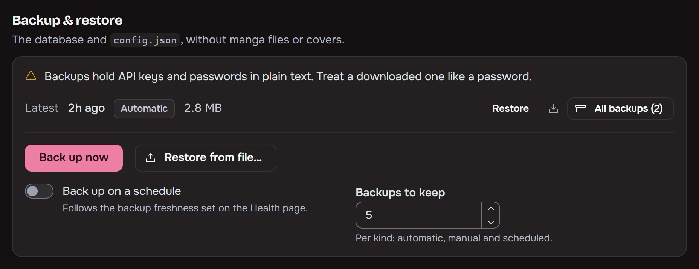

**Settings → System → Backup & restore** takes zip snapshots of the database plus `config.json`,
which together are everything that cannot be cheaply regenerated. The MangaBaka dump, embeddings,
covers and cache are excluded so backups stay small. Backups live in `{ConfigDir}/backups`. By
default Maki keeps the newest 5 of each kind (automatic, manual and scheduled), and the **Backups to
keep** setting changes that.

Maki also backs up automatically **before any upgrade applies a database migration**. Migrations are
forward-only, so this is your recovery path if an upgrade goes wrong.

:::caution
Backups hold API keys and passwords in plain text: the keys, tokens and passwords Maki uses to reach
other services, such as indexers, the download client, Kitsu and MangaUpdates, and notification
connections. Only the passwords you sign in to Maki with and Maki's own API keys are stored as
hashes. Treat a downloaded backup like a password.
:::

**Restoring** replaces the database and settings, then restarts Maki.

- Under Docker (`restart: unless-stopped`) or systemd, it comes back on its own.
- The Windows app restarts Maki too. A bare `dotnet run`, or a tarball started by hand instead of
  through systemd, stays down until you start it again.
- You can restore a backup from another machine, but not one from a newer Maki version or one older
  than this build's oldest migration.
