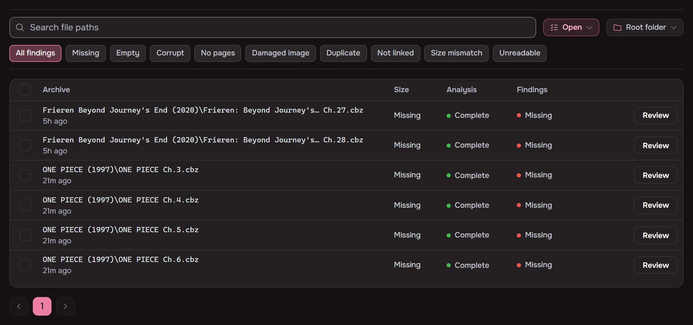
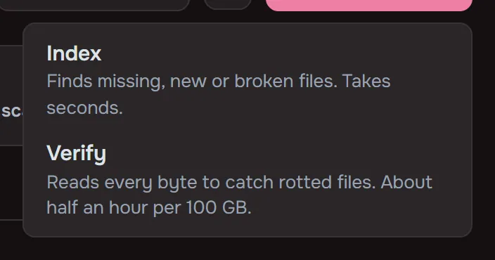
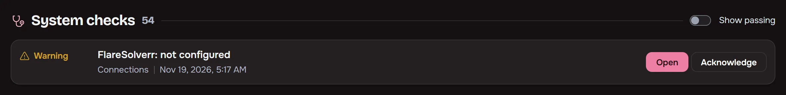
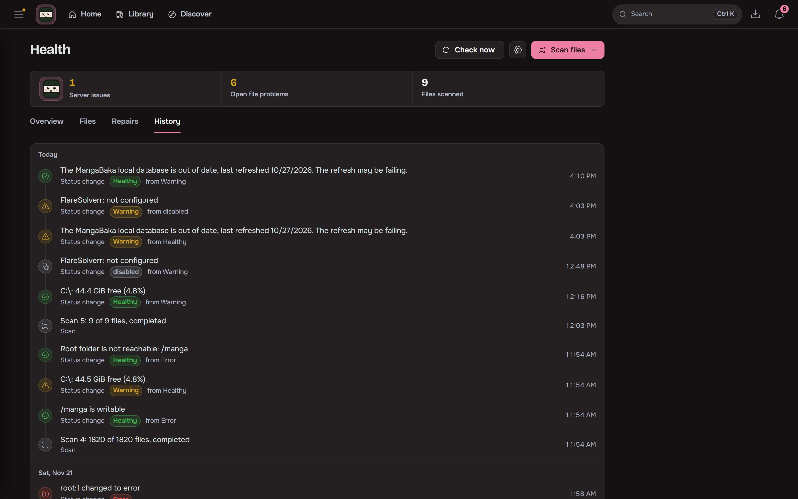
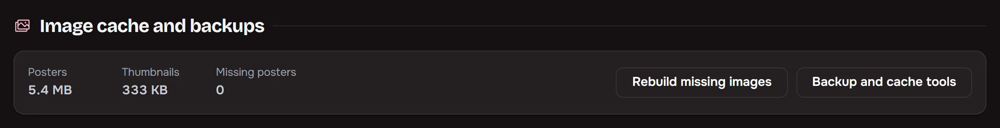
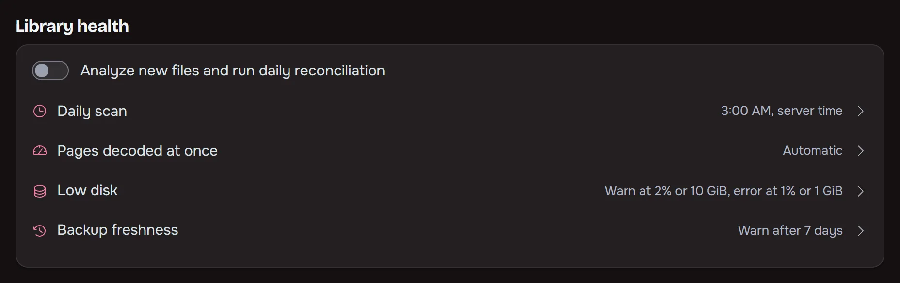

The Health page lists problems Maki has noticed in your setup and files. Only admins can open it,
because it shows file paths. The sidebar item shows the open problem count and turns red when one is
an error.

## When checks run

- System checks run every 15 minutes. **Check now** runs them immediately.
- Custom sources are probed every six hours, since a probe can take minutes.
- File scans run once a day at **Daily scan hour**. New files are analysed as they arrive. Turning
  off **Analyze new files and run daily reconciliation** under **Settings → System → Library
  health** stops both the daily scan and new-file analysis. **Scan files** still works by hand.

## What the system checks cover

- **Library:** unreachable root folders, series with no source mapping, and sources that keep
  failing.
- **Storage:** whether each library and download folder is writable, and free space per drive. A
  drive turns to warning or error below the thresholds in **Library health**, as a percentage or in
  GiB.
- **Connections:** whether download clients, indexers, Kavita, FlareSolverr and Suwayomi answer.
  Also notification connections that keep failing, custom sources that no longer match their site,
  and the MangaBaka dump (missing, damaged or stale).
- **System:** backup freshness, the scheduler, the database and the migration history. A backup is
  fresh if newer than the **Backup freshness** threshold, 7 days by default. A database written by a
  newer version of Maki shows as an error, with a link to the backups so you can restore the one
  taken before the upgrade.
- **Downloads:** failed downloads, and sources cooling down after failures.
- **Scheduled jobs:** background jobs that are failing.

File problems are separate. The **Files** tab lists each archive with its findings: missing, empty,
corrupt, no pages, damaged image, duplicate, not linked, size mismatch, ambiguous names, or
unreadable.

## Scan the files

**Scan files** offers two scans. If the Files tab has a root folder selected, the scan covers only
that folder, and the menu says so.

- **Index** finds missing, new or broken files. It takes seconds.
- **Verify** reads every byte to catch rotted files. Expect about half an hour per 100 GB.

## Act on a finding

System checks have these buttons:

- **Open** goes to where it is fixed, such as a custom source's setup wizard or a notification
  connection's settings.
- **Acknowledge** hides the problem from the header count, and **Reopen** brings it back. It means
  "stop telling me", not "this is fine". The check stays on the page, and counts again if its status
  changes.
- **Show passing** lists the healthy checks.
- A source outage row has **Refresh all**, which re-checks every series on that source. Use it once
  the site is back, so chapters released during the outage get queued.

For files:

- Review an archive to see its findings and decide what to do.
- **Import unlinked** imports archives not yet linked to a chapter. The **Unlinked** filter is split
  by reason, such as a file that moved, an identical copy, or a name Maki can't place.
- A damaged file has **Get a new copy**, and a size mismatch has **Update the record**.
- Mark a finding with **Ignore** or **Acknowledge** once you have decided what it means.
- Bulk actions report which files failed.

### Missing files that moved

When an archive goes missing, Maki looks for it elsewhere in the same root folder, by file name, size
and page hashes. A match on all three is relinked by itself after each library scan, for example when
a series folder was renamed outside Maki, and the chapter keeps its read state and history. A match
on the file name alone waits on the **Missing** filter for you to confirm it.

Until a missing file is relinked or dealt with, its chapter says **File missing** on the series
page and is left out of the downloaded count. The series page has a **Relink files** button and a
filter for these chapters.

### Duplicates

A duplicate finding lists every copy and marks the one to keep: the copy a chapter reads from, or
the oldest when none does. Delete a spare from the review with an inline confirm, or use the bar on
the **Duplicate** filter to delete every spare at once. If you delete the copy a chapter reads from
and an identical copy exists, the chapter moves to that copy instead of losing its file.

The **Repairs** tab lists repair and delete requests and their status. Open a failed one to **Retry**
it. A retried deletion comes back for review first. **Dismiss** clears a finished request, and
**Dismiss all** clears a whole group of them. A failed request drops off the list by itself once its
file is gone or has changed since, because a retry could never run. A PDF cannot be repaired, because
Maki has no other copy to replace it from.

## The History tab

The **History** tab is a timeline of status changes, newest first and grouped by day. A check's
entry names the problem and shows the status it moved from. Background jobs appear there too when
their status changes, under readable names. History keeps 90 days of events, and always at least the
newest 300.

## Running now and scheduled jobs

The **Overview** tab shows what Maki is busy with right now, next to its current processor and memory
use: scheduled jobs mid-run, server Enhance for readers, Prepare ahead, page conversion, downloads,
bulk series edits, source matching and the background credit page scan. A job or bulk edit can be
stopped from there, and the conversion pass, the credit scan and the download queue paused.

Below the checks, **Scheduled jobs** lists each background job with when it last ran and when it
runs next. **Run now** starts one straight away.

## Image cache

The **Overview** tab ends with the **Image cache and backups** panel. It shows the space used by
posters and thumbnails, and how many posters are missing. **Rebuild missing images** re-downloads
posters that are missing or do not decode. Thumbnails regenerate on their own as the reader asks for
them. **Backup and cache tools** opens the System tab in settings.

## Tune the checks

Click the gear next to **Check now**, or open **Settings → System → Library health**. You can change
the low disk thresholds (percentage and GiB, for warning and error), backup freshness in days, the
daily scan hour, the time zone, and how many pages are decoded at once.

