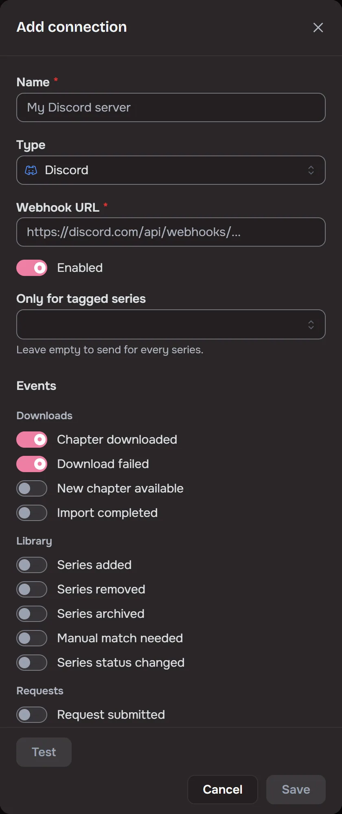
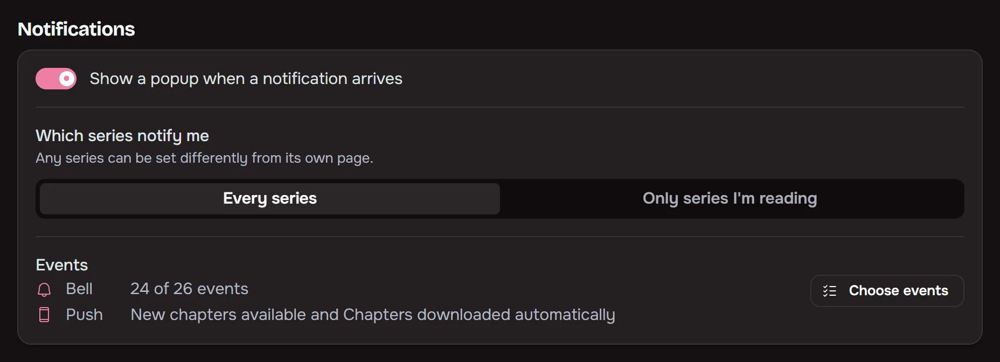
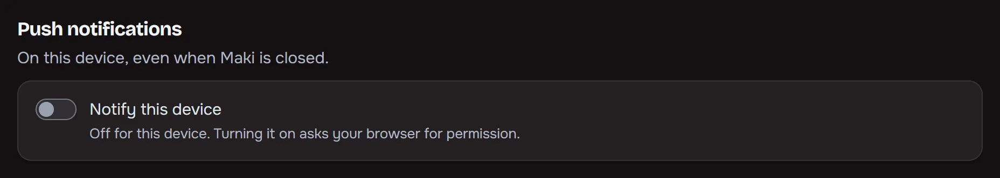

Connections send messages out to services and are set up once by an admin for the whole instance. The
bell and push are personal: what appears in your bell, and what your browsers receive.

## Outbound connections

Admins add them under **Settings → Integrations → Notification connections**. Each connection is one
destination. Types: Discord, Webhook, Telegram, Notifiarr, ntfy, Gotify, Pushover, Apprise, and Slack /
Mattermost, which takes any Slack-compatible webhook, Rocket.Chat included. A Webhook connection POSTs each event as JSON to a URL you choose, with an optional
bearer token.

Every connection has a name, an **Enabled** switch and its own list of events. **Test** sends a test
message and ignores tag scoping. A failed send shows the HTTP status, a timeout, or a network
failure.

### Events

- **Downloads:** Chapter downloaded, Download failed, New chapter available, Import completed.
- **Library:** Series added, Series removed, Series archived, Manual match needed, Series status
  changed.
- **Requests:** Request submitted, Request resolved. Hidden while single-user mode is on, which
  turns on by itself when only one account is enabled.
- **System:** Health issue, Update available.

### Tags

**Only for tagged series** limits a connection to series carrying one of the chosen tags. Messages
without a series, such as imports, updates and health warnings, always go through. A just-added
series has no tags yet, so a tag-scoped connection never sees **Series added**.

### What messages contain

- Discord, Telegram and Pushover upload the series cover with the message.
- Discord messages have their own colour and icon for every event, and ntfy messages their own tag.
  ntfy sends download failures and health problems at high priority unless the connection sets its
  own priority.
- Links in messages are relative paths, because Maki has no setting for its public address, and most
  providers leave them out.
- Discord and Webhook messages use the instance's default language, because a channel has no
  language of its own.
- Tokens and keys are stored in plain text in Maki's config directory. Protect it like the database.

### When deliveries fail

After five failed deliveries in a row, the connection shows as a warning on the Health page. See
[Health checks](/Maki/guides/running/health-checks/).

## Your bell and popups

Each account picks its own events under **Settings → Preferences → Notifications**.

- **Show a popup when a notification arrives** shows a toast while Maki is open.
- The event table has a **Bell** column and a **Push** column. Push sends to your devices and needs
  Bell on for the same event.
- **Which series notify me** sets a rule per series, from its own page: **Default**, **Every
  chapter**, **While reading** (series you are partway through) or **Muted**. Muted sends nothing
  from that series, except that admins still get download failures.

The **Discover** group has **New sequels and spin-offs**, which tells you when the catalogue lists a
new sequel, prequel, spin-off or side story of a series you read, and opens it in Discover. Series
already in your library before v0.37.0 don't announce the related works they already had.

Series events go to people who have read or requested that series. If nobody has, admins receive the
event, so a new series is never silent.

The bell keeps at most 200 entries per account, unread ones included. Read entries are removed after
30 days.

## Browser push

Push reaches a device even when Maki is closed. It needs HTTPS or `localhost`.
[Offline reading and push](/Maki/guides/reading/offline-and-app/) explains the requirement and what
else changes on plain HTTP.

1. Open **Settings → Preferences → Push notifications** on the device.
2. Turn on **Notify this device** and allow the browser's prompt.
3. Click **Send test** to check it arrives.

Good to know:

- On iPhone and iPad, push only works for Maki added to the home screen and opened from there.
- If the browser blocks notifications for the site, change that in the browser's site settings.
- New chapters and finished downloads push by default. Use the Push column for other events.
- Each account can have up to 20 devices. Adding one past that removes the oldest.
- **Sign out everywhere else** also removes the push subscriptions of your other devices. The device
  you are on re-subscribes on its own.
