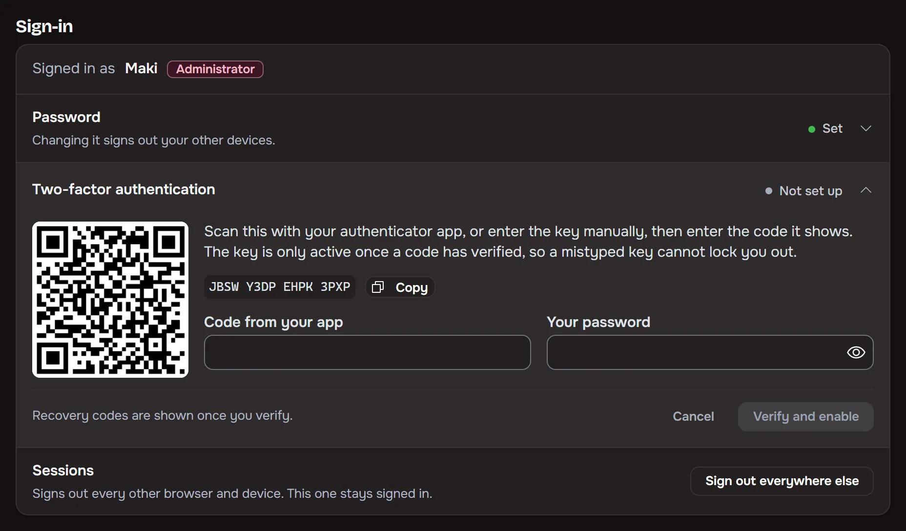
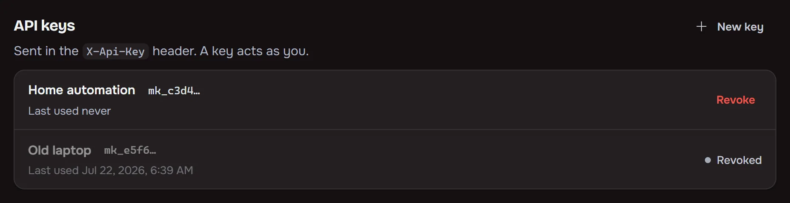

Both belong to one account, so one reader's setup never changes anyone else's.

## Turn on two-factor

Open **Settings → Account → Sign-in** and click **Set up** in the Two-factor authentication card.

1. Scan the QR code with an authenticator app, or type the key shown under it.
2. Enter the code from the app and your password, then click **Verify and enable**.
3. Save the recovery codes Maki shows you.



The key only becomes active once a code verifies, so a mistyped key cannot lock you out. Recovery
codes are shown once and stored hashed, so nobody can read them back, including you. Keep them
somewhere you can reach without your phone. Each code works once.

At sign-in, Maki asks for the code after your password. Tick **Trust this device for 30 days** to
skip the prompt in that browser. If you cannot reach your app, choose **Use a recovery code**.

- The Sign-in card shows how many recovery codes are left.
- **New recovery codes** asks for your password and a current code, and replaces the old set.
- **Disable** asks for your password and signs out your other sessions.
- Admins can reset two-factor for another account from **Settings → Users**, for example after
  someone loses their phone.

Sign-in and two-factor attempts are limited to 10 a minute per client address. Past that, Maki
refuses for a moment and tells the browser when to retry.

:::tip
Turn two-factor on before you expose Maki to the internet. [Reverse proxy and
HTTPS](/Maki/installation/reverse-proxy-https/) covers the rest of that setup.
:::

### Single sign-on

Maki does not ask for its code on the single sign-on path, because your identity provider handles the
second factor. A code you set up still protects password sign-in. See
[Single sign-on](/Maki/installation/single-sign-on/).

## API keys

Open **Settings → Account → API keys** and click **New key** at the top of the card. In the form
that opens, type a name such as "Phone reader", enter your password, and click **Create**. An account that cannot sign in with a password, because it uses single sign-on only
or **Require single sign-on** switched password sign-in off, is not asked for one. It needs a sign-in
from the last ten minutes instead, and the form says so up front with a **Sign in again** button that
brings you back.

The key appears once in a dialog titled **Your new API key**. Maki stores only a fingerprint, so if
you lose it, revoke it and create another. Create one key per script or app so you can revoke one
without touching the rest.

The table lists each key's name, prefix and last use. **Revoke** stops anything using that key
immediately and cannot be undone. Revoked keys stay in the table, greyed out.



### What a key can reach

A key has the same access as the account that made it, across the REST API under `/api/v1`. Send it
in the `X-Api-Key` header:

```
X-Api-Key: <your key>
```

Maki reads keys from that header only, never the query string, because URLs end up in browser history
and proxy logs.

OPDS feed tokens are a separate kind of key, created on the OPDS catalogue card under **Settings →
Reading**, with the same password or recent sign-in check. They work only on the OPDS catalogue, and
Maki rejects them on `/api/v1`, so a reading app holding a feed URL cannot manage your library. See
[OPDS apps](/Maki/guides/reading/opds-apps/).

If you restore a backup, any key you revoked after that backup was taken stays revoked. See
[Backup and restore](/Maki/guides/running/backup-restore/).
