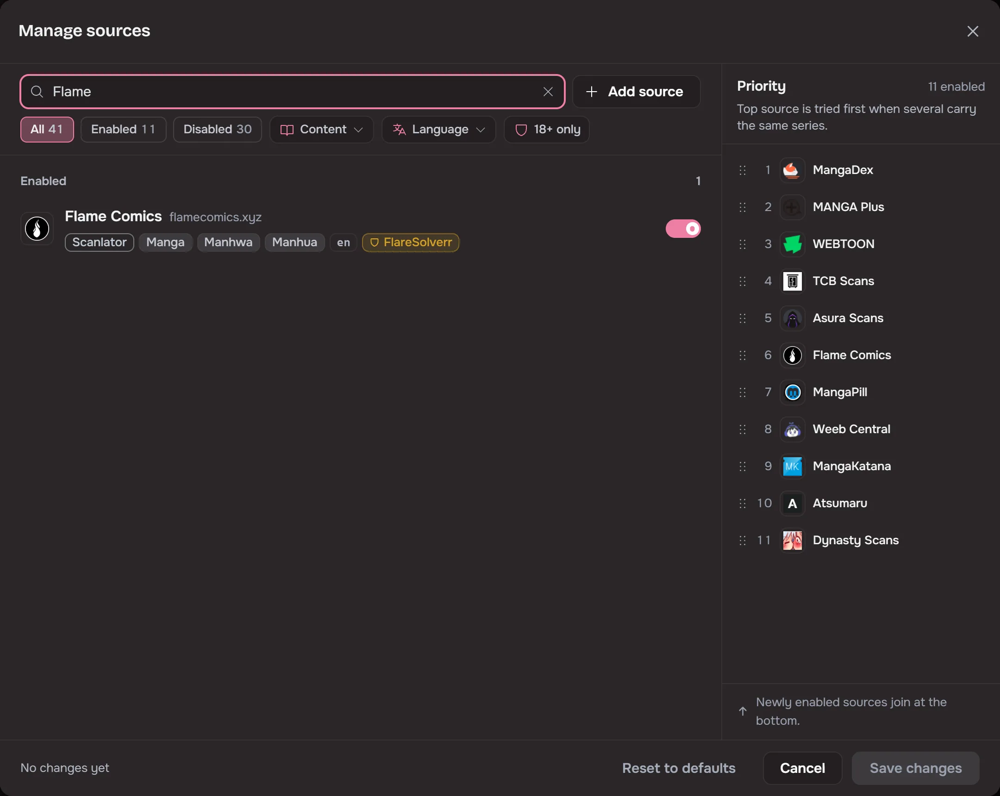
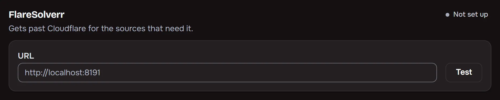

Some sites put a Cloudflare check in front of their pages, which Maki's normal HTTP client can't
pass. For those sites Maki hands the request to
[FlareSolverr](https://github.com/FlareSolverr/FlareSolverr), a separate service that drives a real
headless browser, solves the check, and returns the page with the cookies and user agent it used.
Maki tries those cookies first on later requests to the same site and asks FlareSolverr again only
when the site challenges it.

## Which sources need it

These built-in sources are tagged **FlareSolverr** in Manage sources:

- MangaFire
- Weeb Central
- Flame Comics
- TopManhua
- Olympus Scanlation
- MangaKakalot
- Team-X
- Manhwa18.net
- Toonily
- Anime-Sama
- Rawkuma

Cứu Truyện uses FlareSolverr only when its site serves a challenge. The other built-in sources don't need it.

Custom sources whose definition turns on **Needs FlareSolverr** in the wizard are tagged
**FlareSolverr** in Manage sources. See [Custom sources](/Maki/guides/sources/custom-sources/).

If a source needs FlareSolverr and no URL is set, Maki's health checks warn about it and the queue
says the source needs it to get past its anti-bot check.

## Run it

Run FlareSolverr as its own container on the same Docker network as Maki. The
[companion services](/Maki/installation/companions/) page has a compose file. FlareSolverr listens
on port `8191`.

Inside a container, `localhost` means that container. If Maki and FlareSolverr are services in one
compose file, use the service name, for example `http://flaresolverr:8191`.

## Set the URL in Maki

1. In **Settings → Downloads**, find the **FlareSolverr** card.
2. Enter the URL, such as `http://flaresolverr:8191` (the placeholder shows `http://localhost:8191`).
3. Select **Test** to check that Maki can reach it, then save. The card keeps the last result:
   **Connected** or **Failed** with the reason and when it ran, or **Not tested**. Changing the
   address puts it back to Not tested.

:::caution
Each solve opens a browser tab in FlareSolverr for up to 60 seconds. Maki runs at most two solves at
once. On a small machine, FlareSolverr can run out of memory before Maki does, so give the container
enough memory for two browser tabs.

MangaFire and TopManhua also run a headless browser inside Maki for their requests. It closes after
one idle minute, so the first search or sync after a quiet minute can take up to a second longer.
:::

## When a source still fails

Hover the **Error** label on the source's row on the series page to read its last error. Check that
the FlareSolverr container is running and that Maki can reach the URL, then retry the download.
