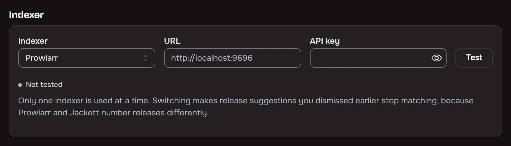
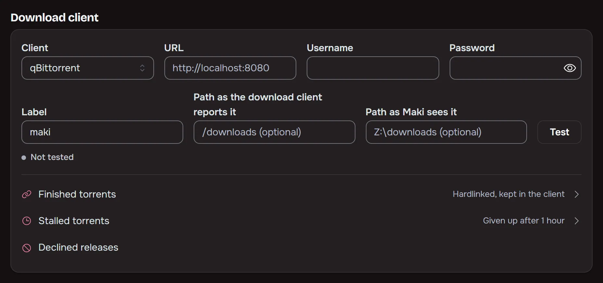
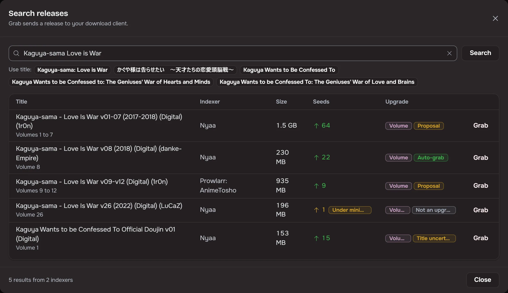
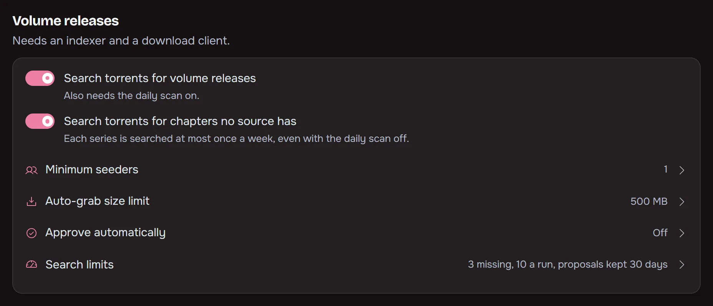
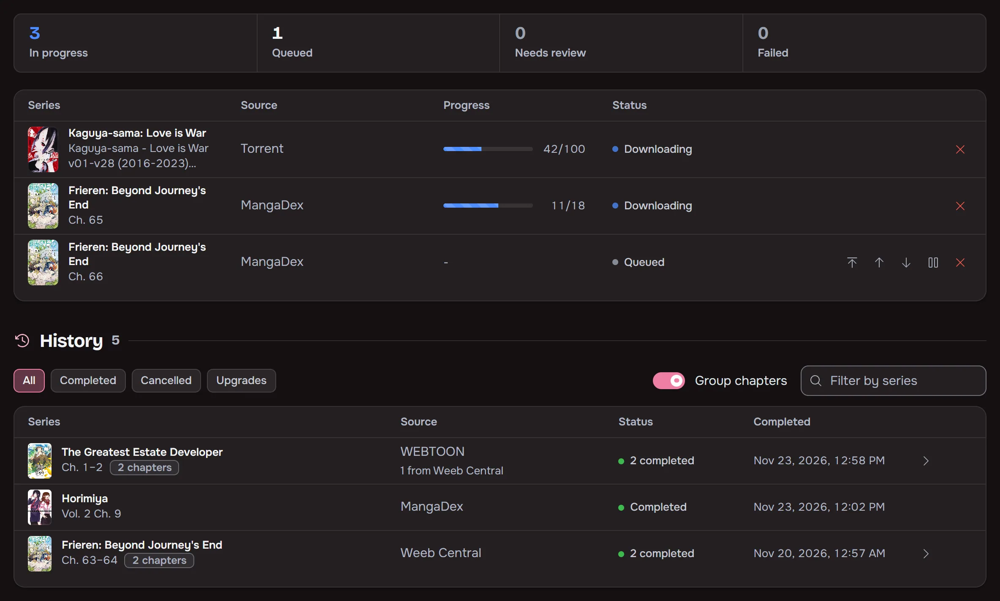

Torrents are an optional second path next to the scraper sources. Maki searches an indexer for a
release, sends the torrent to a download client, and imports the files when it finishes. This needs
both an indexer and a download client. Scraper sources need neither.

## Indexers

Under **Settings → Downloads → Indexer**:

1. Pick **Prowlarr** or **Jackett**.
2. Enter its **URL** (placeholders: `http://localhost:9696` for Prowlarr, `http://localhost:9117` for
   Jackett).
3. Enter the indexer's **API key**, then select **Test**.
4. Choose which indexers to search and which categories to use, then save.

Maki uses one indexer at a time. Switching between Prowlarr and Jackett makes release suggestions you
dismissed earlier stop matching, because the two number releases differently.

## Download clients

Under **Settings → Downloads → Download client**, choose qBittorrent, Transmission or Deluge (one
active at a time).

- **URL**: the client's web address. Each client shows its own default as a placeholder.
- **Username**: used by qBittorrent and Transmission. Deluge's web UI has only a password, so the
  field is hidden.
- **Label**: the tag Maki puts on its torrents so it can find them again (placeholder `maki`). Maki
  refuses a label that Deluge won't accept.
- **Path as the download client reports it** and **Path as Maki sees it**: fill in both when the
  client and Maki see the downloads folder at different paths, for example in different containers.
  Without them, Maki can't find the files after a download.

The **Finished torrents** switches control what happens after an import:

- **Hardlink imported torrents when possible** links the files into your library and leaves them in
  place, so the torrent can keep seeding. Both folders must be on the same filesystem, otherwise
  Maki copies the files.
- **Remove torrents from the download client after import**, with **When to remove**: **Right after
  import**, or **After seeding**. After seeding takes a **Seed ratio**, a **Seeding time (minutes)**
  or both, and the torrent goes once it reaches either. When you add a download client Maki reads its
  own seed limits (qBittorrent's ratio and seeding time, the ratio limit from Transmission and
  Deluge), and **Read from** the client reads them again later. Maki checks the targets itself, so a
  torrent you paused by hand is not mistaken for one that finished seeding.
- **Also delete the downloaded files** removes the files with the torrent, but only when the import
  placed every library file itself, the download doesn't overlap a root folder, the torrent wasn't in
  the client before the grab, and the switch above is on.

## Getting a release

- On a series page, select **Search releases**, pick a result and select **Grab**.
- In the series actions menu, **Upgrades → Search volume releases** looks for a whole-volume release.
- To search automatically, turn on **Search torrents for volume releases** under **Settings →
  Downloads → Volume releases**. It also needs the daily upgrade scan on. **Auto-grab size limit**
  sets which releases Maki grabs on its own. Larger ones become proposals you approve by hand.
- **Search releases** keeps the series title in the search box when nothing turns up, says which
  titles it searched, and has buttons that put an alt title in the box. The search also tries the
  series' original title.

The Volume releases card has more controls:

- **Search torrents for chapters no source has**, on by default, searches your indexers for wanted
  chapters of monitored series that no source lists, such as a licensed title a site took down or a
  series with no source at all. Each series is searched at most once a week, a few at a time, and it
  works with the daily scan off. Releases Maki is unsure about wait for your approval.
- **Minimum seeders** (1 by default). Releases with fewer seeders are never grabbed or approved on
  their own, and no-seeder releases are skipped. The release search marks them, and you can still
  grab them by hand.
- **Approve automatically** opens **Approve volume releases automatically**. Off by default, it grabs
  a proposed digital release under the **Automatic approval size ceiling (MB)** on the same page
  (12 GB by default) when the only reasons it waited were a missing volume range, chapters you don't have, or the auto-grab size. Anything Maki is
  unsure about, including a release whose language is in doubt, still waits for you. An approved
  release only replaces files it is at least as good as, and those go to the trash.

### Volume releases first

**Look for volume releases first**, under **Settings → Downloads → Sources**, is off by default.
When you add a series with nothing on disk, Maki asks your indexers for a volume release as soon as
its sources are matched, before downloading anything chapter by chapter. It follows the series'
quality profile: a profile that doesn't upgrade to volumes downloads from sources as before.

- While that search runs, while a volume release waits for your answer (up to 48 hours) and while
  one downloads (up to 72 hours), monitoring and Smart Download skip the chapters it covers.
  Chapters past its last volume download as usual, and skipped ones are queued once the wait ends if
  the release did not bring them.
- Series from an import list are searched a few at a time, and their source downloads wait up to a
  day for it.
- Downloads you start yourself and request approvals are never held. The series page says what is
  waiting and has **Download from sources now**.

### What a volume covers

When your sources list chapters without volumes, the volume search reads MangaDex's chapter-to-volume
list for series linked to MangaDex, filling gaps in the English list from other languages. A volume
file only takes the chapters its page names list, so a source whose volume boundaries disagree with
the file cannot pull in chapters from the next volume.

### Language

A release tagged in the other of Japanese and English is ignored, and the release list shows why. A
series whose files are Japanese only takes a release on its own when its title says it is Japanese.
Any other release, and any release for a series whose files are in more than one language, waits for
your approval. For a Japanese series the search keeps going until it finds a Japanese release.

## From torrent to CBZ

1. The grab sends the torrent to your download client, tagged with the label you set. The download
   appears in the Activity queue.
2. Maki checks the client for progress. When the torrent completes, Maki reads where the client saved
   it, through your path settings.
3. Maki imports the files into the series folder. CBZ and ZIP files are placed unchanged, since a
   CBZ is a ZIP. `.cbr`, `.rar`, `.7z` and `.tar` files are repacked as CBZ, and a folder of loose
   images becomes one CBZ per folder. A PDF is kept as it is and read in place. A pack with one
   folder per volume, such as "Title v01-08", is imported as one file per volume. A pack that isn't
   cleanly divided into volume folders is imported whole. When a pack's title names no release
   group, the group comes from the file names inside.
4. If an import would replace chapter files you already have, the queue asks you to decide before
   anything changes.

The [monitoring and downloads](/Maki/features/monitoring-and-downloads/) page covers the rest of the
import rules, including how Maki rejects a release that names a related work better than the series.

## When a torrent stalls

The queue reports these problems:

- **The torrent never appeared in the download client**: Maki added it, but the client doesn't list it.
  Check the client's URL, login and label.
- **The torrent is no longer in the download client**: it was deleted in the client, moved to another
  category or label, or dropped.
- **The download client reports an error on this torrent**: open the torrent in the client for its
  own message.
- **The torrent made no progress within the stall limit**, or **No seeds or peers connected to the
  torrent within the stall limit**.

The stall limit is **Give up after (hours)** under **Stalled torrents** on the Download client card,
one hour unless changed, and 0 turns it off. A torrent with no progress, or no seeds or peers, for
that long fails with one of the reasons above, is taken out of the client if Maki added it, and is
declined so the automatic search never grabs it again. The search then looks for the next best
release. A magnet that never finds anyone to fetch its metadata from counts too. A restart shorter
than the limit does not start the clock over. Releases with no seeders are skipped in the first place, and a release
that overlaps a torrent still downloading for the series is not grabbed.

**Declined releases**, on the same card, lists every release the search skips. **Allow again** lets
the next search take one.
