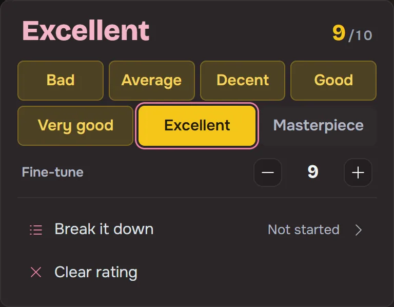
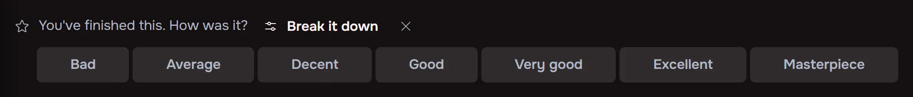
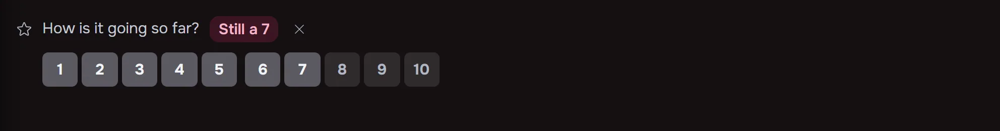
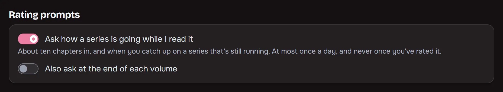
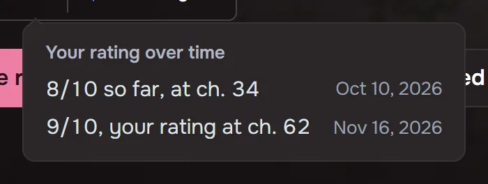

A series can carry one rating from 1 to 10. Partway through a series you can also set a "so far" score. It is kept apart from your final rating and steers recommendations less.

## Rating a series

On the series page, press **Rate** (or your current score) to open the rating panel, then pick a word. Each word sets a whole score: **Bad** is 3, **Average** 5, **Decent** 6, **Good** 7, **Very good** 8, **Excellent** 9 and **Masterpiece** 10. **Fine-tune** moves the score up or down by 1, or by 0.1 when **Rating precision** is set to **One decimal** in **Settings → Reading → Ratings**. Press the number to type a score. The panel saves when you close it.

A series you have not started, or have finished, takes a final rating. A series you are partway through takes a "so far" score, shown with the chapter it was set at, for example "so far, at ch. 34".

Once you finish a series, the series page asks "You've finished this. How was it?" The words there set the final rating. The reader's end screen asks the same on the last chapter of a series you have finished, with a one-tap **Keep** if you gave it a score so far. Maki refuses a "so far" score on a finished series.

To turn a "so far" score into your final rating, press **Make this my rating** beside it, or **Keep** on the finished-series line. A final rating replaces the "so far" score. **Clear rating** removes either one.

**Break it down** scores the series category by category (Story, Art, Characters and so on) with the same words. Once two categories are scored, the panel suggests an overall score and **Use** takes it. **Ending** can only be scored once you have finished the series. Pick which categories show under **Breakdown categories** in **Settings → Reading → Ratings**.

The library's **My rating** sort and filter use the score you see, so a "so far" score counts as rated there.

## "So far" ratings

Use a "so far" score for an opinion you have formed on the way through. It is not sent to trackers unless you turn that on (see below), and it is replaced as soon as you rate the series for real.

## When Maki asks

Maki asks "How is it going so far?" at a few natural points, on the series page and at the end of a chapter in the reader:

- **Early on.** About ten chapters in, while the series has no "so far" score. For a short series with a known total, it comes sooner.
- **Caught up.** "You're caught up. How is it so far?" when you have read every chapter you have or want from a series that is still running.
- **End of a volume.** "That's the end of a volume. How is it so far?" Only if you turn it on.

Press a word to set the score. With a "so far" score already set, a **Still a 7** button (with your current score) keeps it in one tap. The X dismisses the prompt. Ignoring the line leaves it open.

The limits:

- At most one prompt a day, across all your series.
- Caught-up and volume-end prompts come back for a series at most every 30 days, and only while its "so far" score is stale. A score is stale when it is missing, older than 30 days, or set before you had moved on by a quarter of the chapters you have.
- After three dismissals on one series, Maki stops asking about it. Rating the series resets the count.
- No prompts for finished series, series with a final rating, or series in full incognito.

Both switches are in **Settings → Reading → Rating prompts**. **Ask how a series is going while I read it** is on by default. **Also ask at the end of each volume** is off by default and needs the first switch on.

## Rating history

Once a series has two ratings, a history icon sits beside its rating. **Your rating over time** lists every change with its score, whether it was a "so far" or final rating, the chapter it was set at, and the date.

## Archiving a part-read series

Archiving a series you are partway through asks "Want to rate it before it goes?" in the archive dialog. A word picked there becomes a final rating once the archive goes through.

## Sending ratings to trackers

Each tracker block in **Settings → Integrations → Trackers** has two switches. See [Connect a tracker](/Maki/guides/trackers/connect/) for the full list.

- **Sync ratings** sends your final ratings.
- **Also sync "so far" ratings** sends "so far" scores too. It needs **Sync ratings** on and is off until you turn it on.

The first time you set a "so far" score while a rating-syncing tracker is signed in, Maki asks once whether to send those scores to it. Your answer is stored per tracker and you can change it later in Settings. Closing the question stores nothing, so it comes back after a page reload. Clearing a "so far" score clears it on the tracker as well.

**Import ratings** always brings in final ratings, whatever the tracker's score was.

## How ratings shape recommendations

- A final rating above 5 pulls similar titles up, more the higher the score. A 5 is neutral.
- A final rating of 1 to 4 pushes similar titles down, more the lower the score. Unlike a thumbs down, the title itself is not hidden.
- A "so far" score steers less than the same number as a final rating. It grows stronger the further you read. A "so far" score of 1 to 4 pushes similar titles down too, more gently.

For thumbs, hiding and the other feedback controls, see [Tune what you see](/Maki/guides/recommendations/feedback/).
