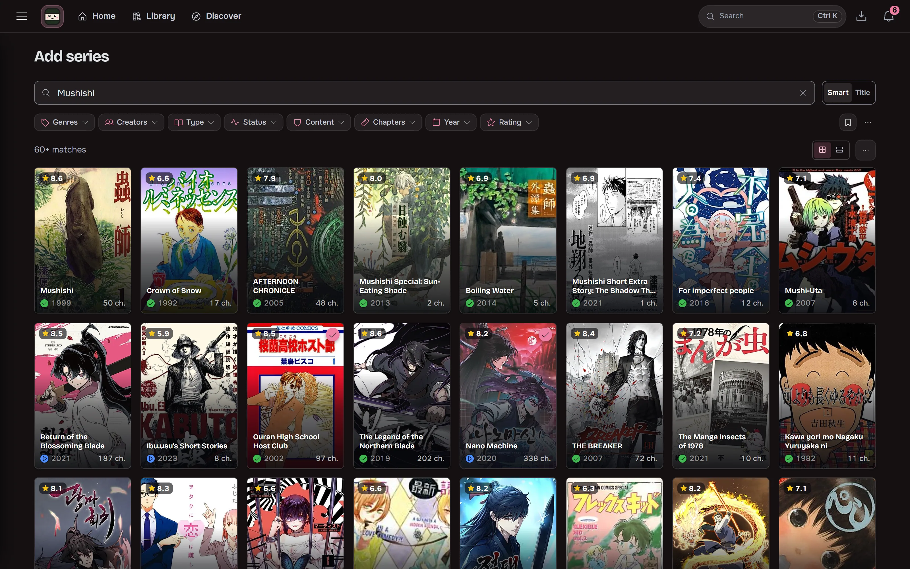
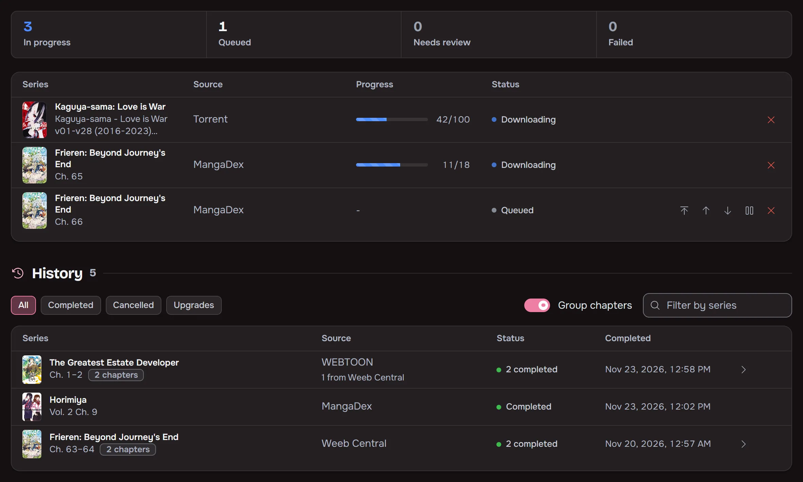

Maki is one server with a web interface. It does four jobs.

## 1. Find

You add a series by searching the local copy of the [MangaBaka](https://mangabaka.org) database.
One match identifies the series and brings along its MyAnimeList, AniList, MangaUpdates and Kitsu
IDs. Maki then links the series to the [sources](/Maki/guides/sources/built-in-sources/) that carry it.

## 2. Watch

Maki checks your sources on a schedule and picks the best one for each series. Checks slow down as
a series goes quiet: every 30 minutes for six hours after a new chapter, every two hours for two
weeks, every six hours up to 60 days, then once a day. Completed series get the daily check after
two weeks. New chapters are queued on their own, and you can follow the queue under **Activity**.

With an indexer and a download client connected, Maki can also fetch chapters no source has from
torrents, and grab whole volume releases. See [Torrents](/Maki/guides/sources/torrents/).

## 3. Save

Each chapter is downloaded page by page and written as a CBZ file with ComicInfo.xml metadata
into your library folder. The files are plain and portable, so Kavita, KOReader, Panels, Chunky,
Mihon and other comic readers can open the same folder.

## 4. Read and track

Read in Maki's own reader, over [OPDS and the Komga-compatible API](/Maki/guides/reading/opds-apps/),
or in [KOReader](/Maki/guides/reading/koreader/). Progress from every app is merged and sent to
your trackers, along with your reading status, such as On hold, Dropped or Completed.

## Where the data lives

- `/config` volume: database, logs, covers, page cache and `config.json`. The Windows app keeps
  the same files in `%LOCALAPPDATA%\Maki`.
- `/library` volume: chapters.

Back up both. See [Backup and restore](/Maki/guides/running/backup-restore/).
